# Sesión de Auditoría de Producto: Casos de Uso del Sistema BC (Bus Conectado)

**Proyecto:** Ecosistema Digital de Transporte Urbano - Tacna, Perú  
**Fase:** Auditoría y Refinamiento Funcional de Casos de Uso (CU-00, CU-01, CU-02, CU-04)  
**Fecha:** Noviembre 2026  
**Auditoría y Revisión:** Equipo de Arquitectura de Software y Producto  

---

## 1. Resumen Ejecutivo de la Auditoría

La presente sesión de auditoría técnica y de producto revisa la factibilidad operativa, la experiencia de usuario (UX) en campo y la robustez arquitectónica de los casos de uso núcleo del **Sistema BC**.

Se analizan cuatro áreas críticas levantadas durante la revisión:
1. **Fricción de Autenticación (CU-00):** Supresión del despacho repetitivo de OTP de 6 dígitos en ingresos recurrentes y consolidación de sesiones persistentes.
2. **Eficiencia en Abordaje y Telemetría (CU-01):** Viabilidad de QR estático comercial para pasarelas existentes y eliminación del consumo de batería mediante desacoplamiento GPS pasajero-bus.
3. **Resiliencia en Cobros Yape/Plin (CU-02):** Calibración de ventanas de timeout de 5 a 10 segundos y priorización de validación visual asistida por el chofer.
4. **Gobierno Operativo y Seguridad en Conducción (CU-04):** Desacoplamiento del cambio automático de ruta (Ida/Vuelta) y restricción estricta de invisibilidad en mapa público solo ante fallas mecánicas auditables.

---

## 2. Matriz de Hallazgos y Decisiones de Auditoría

| Caso de Uso | Aspecto Evaluado | Observación Original | Decisión de Auditoría / Solución Técnica | Impacto |
| :--- | :--- | :--- | :--- | :--- |
| **CU-00** | Frecuencia de OTP (6 dígitos) | Se solicita código en cada inicio/apertura de app, generando alta fricción y gasto SMS. | **OTP Exclusivo para Onboarding:** Se usa solo en registro inicial o cambio de terminal. La sesión se mantiene permanente mediante `Refresh Tokens` (90 días). | Reducción del 98% en costo de pasarelas SMS y eliminación de fricción en paraderos. |
| **CU-01** | Viabilidad QR Yape/Plin & Consumo Batería | Duda sobre viabilidad de QR unificado y alto consumo de batería por GPS del pasajero. | **1. QR Único Recaudador:** 100% viable asociar la unidad a cuenta recaudadora de la empresa. **2. Cero GPS en Pasajero:** La ubicación es telemática del bus; el móvil del usuario apaga su GPS. | Ahorro masivo de batería móvil y simplicidad en la integración inicial de pagos. |
| **CU-02** | Timeout de Pago Bancario (5s) | 5 segundos resulta insuficiente ante latencia de red móvil y pasarelas interbancarias. | **Ventana de 10s + Fallback Visual:** Se extiende el timeout del webhook a 10s. Si vence, se abre validación visual del chofer mediante botón físico/táctil. | Se evitan bloqueos en la puerta y falsos rechazos a usuarios con comprobante real. |
| **CU-04** | Sentido de Ruta & Pausa en Mapa | Cambio automático relativo de sentido y botón libre de "pausar mapa" que compromete seguridad. | **Control Asistido + Falla Mecánica Obligatoria:** Sentido manual confirmado por chofer. Pausa de mapa **bloqueada** salvo ante avería mecánica comprobable (CU-04.A). | Garantiza transparencia para el pasajero y evita que choferes "desaparezcan" de ruta a discreción. |

---

## 3. Análisis Detallado por Caso de Uso

```mermaid
flowchart TD
    subgraph CU00["🔑 CU-00: Autenticación"]
        A1[Registro Inicial] -->|OTP SMS/WhatsApp| A2[Sesión Persistente Keychain]
        A2 -->|Apertura Diaria| A3[Acceso Inmediato sin Códigos]
    end

    subgraph CU01["🚌 CU-01: Abordaje & GPS"]
        B1[Escaneo de Cobro] --> B2[Asociación a Bus ID]
        B2 --> B3[GPS Móvil APAGADO]
        B3 --> B4[Telemetría Proyectada desde Bus]
    end

    subgraph CU02["📱 CU-02: Yape/Plin"]
        C1[Pago Pasarela] --> C2{¿Webhook <= 10s?}
        C2 -- No --> C3[Validación Visual Manual Conductor]
        C2 -- Sí --> C4[Aprobación Automática POS]
    end

    subgraph CU04["🗺️ CU-04: Control de Flota"]
        D1[Turno en Ruta] --> D2{¿Avería Mecánica?}
        D2 -- No --> D3[Mapa Público SIEMPRE ACTIVO]
        D2 -- Sí --> D4[CU-04.A: Pausa Autorizada + Reembolso]
    end
```

---

### 3.1. Caso de Uso CU-00: Autenticación y Persistencia de Sesión

#### Diagnóstico del Problema:
1. **Fricción Extrema en Campo:** Exigir un código OTP de 6 dígitos cada vez que un ciudadano aborda o abre la aplicación en un paradero genera demoras intolerables, filas y exclusión de usuarios de la tercera edad o con baja familiaridad tecnológica con SMS/WhatsApp.
2. **Costo Financiero:** Cada SMS despachado mediante servicios como Twilio o Meta WhatsApp Cloud API tiene un costo operativo directo en dólares. Despachar un OTP por cada apertura de app haría inviable el modelo financiero del sistema de transporte.
3. **Naturaleza del Saldo (Puntos BC):** El monedero contiene **puntos cerrados de transporte** que carecen de liquidez fuera de la red de buses (no se pueden transferir a terceros ni retirar en efectivo). Por ende, el riesgo de fraude financiero ante un teléfono extraviado no justifica una barrera de seguridad bancaria invasiva.

#### Directiva de Auditoría:
* **OTP Exclusivo para Onboarding y Recuperación:** El código de 6 dígitos se despacha únicamente cuando:
  1. El usuario se registra por primera vez con su número celular.
  2. El usuario cambia de smartphone o reinstala la app.
  3. El usuario cerró sesión manualmente desde su perfil.
* **Persistencia Criptográfica Local:**
  * Al validar el primer OTP, el servidor entrega un `access_token` (JWT de 24 horas) y un `refresh_token` criptográfico de larga duración (90 días con renovación silenciosa).
  * El token se almacena en el enclave de seguridad nativo del dispositivo (`iOS Keychain` y `Android Keystore / EncryptedSharedPreferences`).
  * Cada vez que el pasajero abre la aplicación, entra directo a la pantalla principal sin ninguna pantalla de bloqueo ni petición de códigos.

---

### 3.2. Caso de Uso CU-01: Abordaje, Pagos y Eficiencia Energética

#### Diagnóstico del Problema:
1. **Viabilidad de Códigos QR para Billeteras Digitales (Yape / Plin):**
   * Se cuestionaba la necesidad de generar QR dinámicos complejos para Yape/Plin y si un QR puede estar vinculado permanentemente a la misma cuenta bancaria.
2. **Consumo de Batería por Monitoreo GPS (Sección 1.3):**
   * En la especificación original, mantener activo el GPS del smartphone del pasajero para saber en qué parada baja genera un drenaje severo de batería y alto consumo de datos móviles.

#### Directiva de Auditoría:
* **QR Estático Institucional para Fase 1 (MVP):**
  * **Sí es 100% factible y recomendado.** La empresa de transporte o consorcio dispone de una cuenta recaudadora central (cuenta corriente Yape Empresas / Niubiz).
  * El POS o acrílico en cabina expone el código QR oficial de la cuenta recaudadora. Cada bus cuenta con un código terminal identificador para cuadrar las liquidaciones por unidad.
* **Desacoplamiento Telemático y Ahorro de Batería:**
  * Al momento en que el pasajero realiza el abordaje (mediante la App BC o POS), la relación se establece en el backend:  
    `trip_session = { user_id: 'USR-89', bus_id: 'BUS-12', status: 'ACTIVE' }`.
  * **El smartphone del pasajero APAGA inmediatamente su antena GPS de alta precisión.**
  * Toda la telemetría en tiempo real (coordenadas geográficas, velocidad, cálculo de paraderos restantes y distancia) se lee del módulo GPS telemático del **propio bus** (montado en el POS o tablet del chofer).
  * La app del usuario únicamente escucha un canal liviano de WebSocket o eventos SSE con los datos transmitidos por la unidad, reduciendo el consumo energético del dispositivo en más de un 90%.

---

### 3.3. Caso de Uso CU-02: Timeout de Validación Yape y Comprobación del Conductor

#### Diagnóstico del Problema:
* El límite fijado de **5 segundos** para recibir el webhook bancario automático desde Niubiz/BCP es irreal en la práctica urbana:
  1. La cobertura móvil en diversas zonas de Tacna varía entre 3G y 4G con fluctuaciones de latencia.
  2. Los servidores interbancarios suelen demorar entre 4 y 9 segundos en emitir la confirmación hacia pasarelas externas.
  3. Si el sistema aborta a los 5 segundos, se emiten alertas rojas falsas cuando el dinero ya fue debitado del saldo del usuario.

#### Directiva de Auditoría:
* **Ampliación de Ventana a 10 Segundos:**
  * La ventana de escucha de la pasarela automática se extiende formalmente a **10.0 segundos**.
* **Priorización de la Comprobación Manual / Visual del Conductor:**
  * Si a los 5 segundos no se ha recibido el webhook automático, la pantalla del POS no cancela la operación; en su lugar, cambia a estado de advertencia: `[Verificación con Conductor]`.
  * En la tablet del conductor se habilita un botón visible y prioritario: **`[Validar Manualmente]`**.
  * El pasajero muestra la pantalla de confirmación animada oficial de su app Yape/Plin (verificando nombre del destinatario, monto de S/. 1.50 y hora actual).
  * El conductor pulsa el botón en pantalla; la tablet emite el pitido aprobatorio de cabina, suma +1 al aforo y regulariza la transacción como `CONFIRMADO_VISUAL_CHOFER`.

---

### 3.4. Caso de Uso CU-04: Control de Turno, Sentido de Ruta y Política de Invisibilidad en Mapa

#### Diagnóstico del Problema:
1. **Inversión Automática de Ruta (Ida ↔ Vuelta):**
   * El cambio puramente automático por proximidad geográfica genera errores si el bus llega a un terminal y debe esperar 15 minutos en bahía, si el chofer toma un desvío o si el despachador le indica cubrir un sentido especial.
2. **Botón Libre de "Pausar en Mapa Público":**
   * Permitir que un conductor pause a voluntad su visibilidad en el mapa público de los pasajeros representa un fallo de seguridad, debilita el control de flota y fomenta que conductores apaguen su visibilidad para evadir pasajeros en horarios de baja tarifa (ej. estudiantes).

#### Directiva de Auditoría:
* **Sentido de Ruta Semi-Automático (Confirmación Asistida):**
  * Al detectar que el bus se encuentra dentro del polígono geográfico (geocerca) del terminal de cabecera, la tablet sugiere el cambio de sentido: *"¿Iniciar recorrido de Vuelta (Sentido Sur)?"*.
  * El conductor confirma con un toque en pantalla cuando efectivamente inicia la marcha comercial.
* **Restricción Estricta de la Pausa en Mapa (Fusión con CU-04.A):**
  * **Queda terminantemente prohibido un botón genérico de "Pausar Mapa Público".**
  * La unidad **solo puede salir de la visibilidad pública** si se declara un evento de falla técnica u operativa debidamente categorizado:
    * Falla de Neumático (pinchazo / baja presión).
    * Falla Mecánica / Recalentamiento de Motor.
    * Incidente de Tránsito / Bloqueo de Vía.
    * Emergencia Médica a Bordo.
  * Al seleccionar una falla, se ejecutan las acciones combinadas con **CU-04.A**:
    1. Se registra la alerta con sello de tiempo y coordenadas GPS en la consola web de administración (Backoffice).
    2. La unidad se marca temporalmente como `EN_CONTINGENCIA` en el mapa público (no visible para nuevas esperas).
    3. Si la unidad no puede continuar y lleva pasajeros a bordo, se activa la devolución automática de Puntos BC a las cuentas de los usuarios afectados.

---

## 4. Plan de Acción y Próximos Pasos

1. **Actualización de Documentación:**
   * Actualizar formalmente las especificaciones de requerimientos en `docs/casos_de_uso/` con las enmiendas aprobadas en esta sesión.
2. **Ajuste en Scripts de Base de Datos (`02_Script_SQL_DDL.sql`):**
   * Verificar que la tabla de sesiones de usuario soporte persistencia de tokens de 90 días (`refresh_tokens`).
   * Añadir columna de auditoría `tipo_confirmacion` (`AUTOMATICA_WEBHOOK` vs `MANUAL_VISUAL_CHOFER`) en `ledger_transactions`.
3. **Sincronización con el Prototipo UI (`mockup/index.html`):**
   * Ajustar la pantalla de login del pasajero para reflejar la entrada directa tras el registro inicial.
   * Incorporar en la tablet del conductor el botón de validación visual de Yape y la selección de fallas mecánicas para la suspensión de ruta.

---
*Documento emitido y archivado en el repositorio de ingeniería bajo la carpeta `OBSERVACIONES_CASOS_DE_USO/`.*

