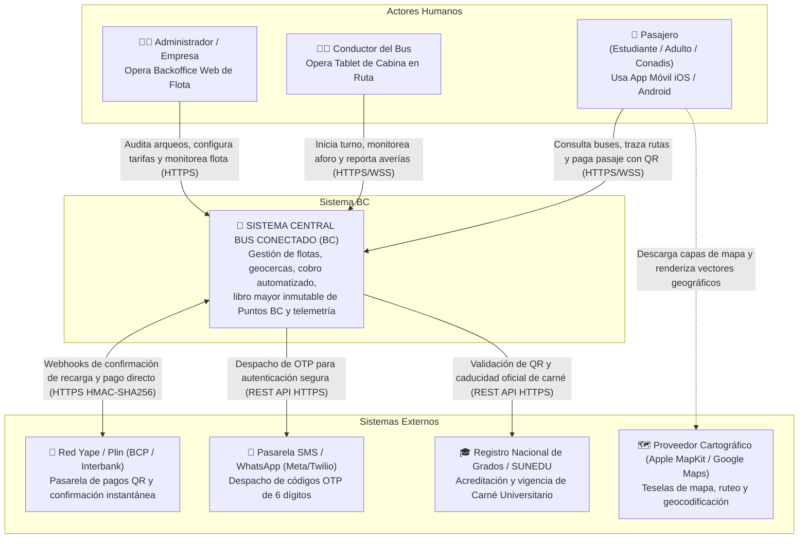

# Documento de Arquitectura C4 — Nivel 1: Contexto del Sistema
## Sistema BC (Bus Conectado) — Transporte Urbano Automatizado (Tacna, Perú)

> **Documento:** `docs/arquitectura/01_C4_Contexto.md`  
> **Versión:** 1.0 (Noviembre 2026)  
> **Estándar:** SWEBOK v4 / Modelo C4 (Simon Brown) — Nivel 1: System Context

---

## 1. Propósito y Alcance

El diagrama de **Contexto del Sistema (C4 Level 1)** establece los límites perimetrales del ecosistema **Bus Conectado (BC)**, identificando a los usuarios humanos directos (actores) y los sistemas externos de interoperabilidad crítica (billeteras digitales, pasarelas de mensajería, registros universitarios y servicios telemáticos).

---

## 2. Diagrama C4 Nivel 1 — Contexto

---

## 3. Catálogo de Actores del Ecosistema

| Actor | Rol en el Sistema | Dispositivo de Acceso | Protocolos Principales |
| :--- | :--- | :--- | :--- |
| **Pasajero** | Consulta paraderos, monitorea ETA del bus en tiempo real, recarga puntos y paga pasaje sin contacto en puerta. | Smartphone personal (iOS 17+ / Android 13+) | HTTPS (REST), WSS (WebSocket Seguro) |
| **Conductor** | Vincula unidad, supervisa el aforo semafórico en cabina, registra pasajeros CONADIS y declara incidencias/averías. | Tablet industrial 10" fija en tablero de bus | HTTPS (REST), WSS (Telemetría local y remota) |
| **Validador POS (Hardware)** | Validador fijo en puerta con pantalla de pasajero, lector óptico de QR y módem 4G LTE telemático. | POS embebido Android / Linux IoT | HTTPS (REST), MQTT / WSS (Telemetría GPS cada 3s) |
| **Administrador de Flota** | Monitorea despacho de unidades, kilómetros recorridos, auditoría de ingresos y conciliación bancaria. | Navegador Web (Chrome / Safari / Firefox) | HTTPS (Web REST API) |

---

## 4. Catálogo de Sistemas Externos e Interoperabilidad

| Sistema Externo | Tipo de Integración | Finalidad Operativa | Failsafe / Contingencia |
| :--- | :--- | :--- | :--- |
| **Yape / Plin API** | Webhook HTTPS entrante con firma criptográfica HMAC-SHA256 | Confirmación de recargas de puntos y pago directo en puerta de personas sin la app instalada. | Validación visual manual por conductor si latencia > 5s. |
| **Pasarela SMS / WhatsApp (Twilio / Meta)** | REST Client HTTPS con autenticación Basic / Bearer | Envío de códigos OTP de 6 dígitos (TTL 5 min) para autenticación sin contraseña (CU-00). | Fallback automático a WhatsApp si SMS no confirma entrega en 60s. |
| **SUNEDU / RENIEC** | REST Client HTTPS (JSON API) | Consulta de autenticidad del Carné Universitario mediante código QR oficial y DNI del alumno (CU-03). | Modo prórroga configurado por backoffice si la API externa entra en mantenimiento. |
| **Apple MapKit / Google Maps SDK** | SDK Nativo en cliente | Proyección de coordenadas, teselas vectoriales de Tacna, trazado de rutas óptimas y geocodificación inversa. | Fallback a coordenadas poligonales cacheadas localmente en cliente. |

---

## 5. Justificación de Decisiones de Contexto

1. **Adopción de Billeteras Móviles Existentes:** Más del 85% del comercio en Tacna utiliza Yape o Plin. El sistema BC no busca competir con las billeteras bancarias, sino interoperar como receptor digital y alimentar el monedero prepago en Puntos BC (1 PEN = 10 Puntos).
2. **Cero Contraseñas Complejas (OTP Estricto):** En entornos de transporte público, los usuarios no recuerdan contraseñas al subir al bus. La autenticación telefónica por OTP garantiza acceso en menos de 20 segundos.
3. **Desacoplamiento de Conectividad:** Si el bus pasa por zonas con sombra de señal 4G en los cerros de Cono Norte, el POS retiene las transacciones en una cola local firmada y las transmite al recuperar enlace.

