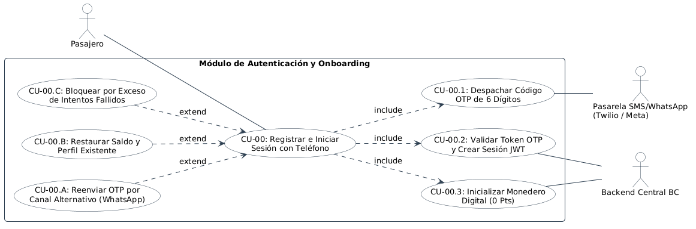

# Especificación Detallada de Caso de Uso: CU-00
## Autenticación OTP por Celular y Creación de Monedero (Onboarding)
**Documento UML:** `docs/casos_de_uso/CU00/CU00_Autenticacion_OTP_Onboarding.md`  
**Referencia UML:** `CU00` en [diagrama_casos_de_uso.puml](file:///Users/aron/githubRepo/sem-bus/docs/casos_de_uso/diagrama_casos_de_uso.puml)  
**Versión:** 2.0 (Análisis Riguroso y QA Ready)

---

## 1. Caracterización Formal del Caso de Uso

| Atributo | Definición Formal |
| :--- | :--- |
| **Identificador** | **CU-00** |
| **Nombre** | Registrar e Iniciar Sesión con Teléfono Móvil (OTP) e Inicialización de Monedero |
| **Nivel** | Subfunción Fundamental / Puerta de Enlace de Seguridad |
| **Actor Primario** | **Pasajero** (Nuevo o Recurrente) |
| **Actores Secundarios** | **Pasarela SMS / WhatsApp (Twilio / Meta Cloud API)**, **Sistema Backend BC** |
| **Partes Interesadas** | *Pasajero:* Acceder en menos de 30 segundos sin contraseñas complejas que se olvidan en el paradero.<br>*Seguridad/QA:* Evitar registros masivos por bots, ataques de fuerza bruta y asegurar idempotencia en la creación del monedero. |
| **Precondiciones** | El usuario tiene la App BC instalada en su smartphone y conectividad a internet móvil (3G/4G/Wi-Fi). |
| **Postcondición de Éxito** | 1. Usuario autenticado con token JWT (y Refresh Token en Keychain/Keystore seguro).<br>2. Si es usuario nuevo: Se crea registro en `users` y monedero inicializado en `0 Puntos BC`.<br>3. Si es usuario existente: Se restaura su saldo de Puntos BC y rol (General o Estudiante). |
| **Postcondición de Falla** | No se genera sesión JWT, el monedero no se expone y la app permanece en vista de ingreso o Modo Invitado. |
| **Disparador (Trigger)** | El usuario presiona *"Iniciar Sesión / Registrarse"* o intenta realizar una acción restringida (recargar o pagar pasaje). |

---

## 2. Diagrama UML de Casos de Uso (Estructura y Relaciones)

<div align="center">
  
  <p><em>Figura: Diagrama UML 2.5 del Caso de Uso con Actores, Caso Base, relaciones &laquo;include&raquo; y &laquo;extend&raquo;.</em></p>
</div>

---

## 3. Puntos de Inclusión (`<<include>>`) y Extensión (`<<extend>>`)

### 3.1. Casos de Uso Incluidos (`<<include>>`)
* **`<<include>> CU-00.1` (Despachar Código OTP de 6 Dígitos):** Generación de token criptográfico temporal (validez 5 minutos) y despacho por SMS o WhatsApp Business API.
* **`<<include>> CU-00.2` (Validar Token OTP y Crear Sesión JWT):** Verificación de firma del token, generación de par `access_token` (1 hora) y `refresh_token` (90 días).
* **`<<include>> CU-00.3` (Inicializar Monedero Digital en 0 Puntos):** Creación atómica del monedero en base de datos garantizando unicidad de cuenta.

### 3.2. Puntos de Extensión (`<<extend>>`)

```
+---------------------------------------------------------------------------------------------------+
| PUNTO DE EXTENSIÓN 1: [PE-FALLBACK-WHATSAPP] (Retraso en Red de Telefonía SMS)                   |
|   Extendido por: CU-00.A (Reenviar OTP por Canal Alternativo de WhatsApp)                         |
|   Condición de Activación: tiempo_transcurrido >= 60 segundos Y usuario presiona 'Reenviar'       |
+---------------------------------------------------------------------------------------------------+
| PUNTO DE EXTENSIÓN 2: [PE-RESTAURAR-CUENTA] (Usuario Recurrente en Nuevo Dispositivo)            |
|   Extendido por: CU-00.B (Restaurar Saldo de Puntos BC y Perfil Existente)                        |
|   Condición de Activación: telefono_ingresado EXISTE_EN tabla 'users'                             |
+---------------------------------------------------------------------------------------------------+
| PUNTO DE EXTENSIÓN 3: [PE-ANTI-BRUTE-FORCE] (Exceso de Intentos Erróneos)                         |
|   Extendido por: CU-00.C (Bloquear Teléfono Temporalmente por Seguridad)                          |
|   Condición de Activación: intentos_fallidos_otp >= 3 intentos en menos de 10 minutos            |
+---------------------------------------------------------------------------------------------------+
```

---

## 4. Descripción Paso a Paso del Flujo

1. **[Ingreso de Número]:** El usuario digita su número de celular (9 dígitos peruanos, ej. `952 123 456`).
2. **[Validación de Formato]:** La app verifica el regex `^9\d{8}$` y despacha: `POST /api/v1/auth/otp/send { "phone": "952123456" }`.
3. **[Despacho de OTP - Inclusión CU-00.1]:**
   * El backend genera un código numérico aleatorio de 6 dígitos con hash almacenado en Redis con TTL de 300 segundos.
   * Invoca a la pasarela (SMS o WhatsApp).
   * La app muestra la pantalla de ingreso de código con un contador regresivo de 60 segundos.
4. **[Ingreso y Validación - Inclusión CU-00.2]:**
   * El usuario recibe el mensaje e ingresa los 6 dígitos.
   * La app despacha: `POST /api/v1/auth/otp/verify { "phone": "952123456", "code": "849201" }`.
   * El backend valida el hash en Redis y elimina el OTP consumido.
5. **[Evaluación de Usuario Nuevo vs. Existente]:**
   * **Rama A (Usuario Nuevo):**
     * Ejecuta **CU-00.3**: Inserta el nuevo usuario con `role = 'ADULT'` y crea su monedero con saldo `0 Puntos BC`.
   * **Rama B (Usuario Existente - Extensión CU-00.B):**
     * Recupera el `user_id` preexistente, su saldo real en el libro mayor y su rol (ej. `STUDENT` con fecha de caducidad).
6. **[Creación de Sesión]:**
   * El backend emite tokens seguros (JWT).
   * La app almacena las credenciales en el almacenamiento seguro nativo (`Keychain` en iOS / `EncryptedSharedPreferences` en Android).
7. **[Finalización]:** La app transiciona a la pantalla principal con el nombre del usuario y su saldo de Puntos BC disponible.

---

## 5. Criterios de Aceptación para QA (Escenarios BDD / Cucumber)

```gherkin
Feature: Autenticación de Pasajeros por OTP Telefónico

  Scenario: Registro exitoso de usuario nuevo por SMS
    Given que el teléfono "952888999" no está registrado en el sistema BC
    When el usuario solicita código OTP e ingresa el código correcto de 6 dígitos
    Then el sistema crea una nueva cuenta con rol "ADULT"
    And inicializa su monedero en 0 Puntos BC
    And entrega tokens JWT válidos de sesión

  Scenario: Recuperación de saldo en nuevo dispositivo
    Given que el usuario con teléfono "952111222" ya existe con 45 Puntos BC y rol "STUDENT"
    When valida exitosamente su código OTP en un teléfono recién instalado
    Then el sistema restaura su sesión con rol "STUDENT"
    And muestra exactamente su saldo de 45 Puntos BC sin pérdidas

  Scenario: Bloqueo por fuerza bruta tras 3 intentos erróneos
    Given que se despachó un código OTP al teléfono "952333444"
    When el usuario ingresa un código erróneo por 3 veces consecutivas
    Then el sistema bloquea el número por 15 minutos
    And retorna error 429 "Demasiados intentos fallidos. Intente más tarde"
```

