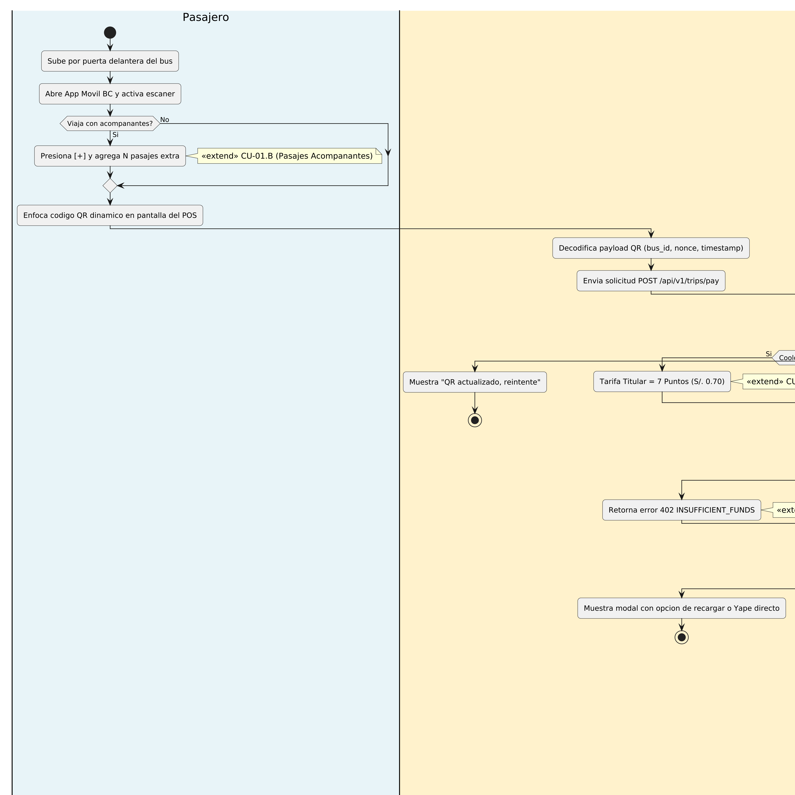
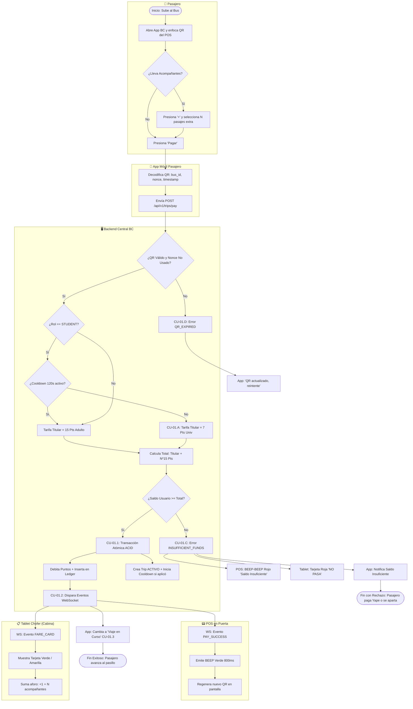

# Especificación Detallada de Caso de Uso: CU-01
## Abordaje y Pago con App en Módulo POS (Flujo Core)
**Documento UML:** `docs/casos_de_uso/CU01/CU01_Abordaje_Pago_App.md`  
**Referencia UML:** `CU01` en [diagrama_casos_de_uso.puml](file:///Users/aron/githubRepo/sem-bus/docs/casos_de_uso/diagrama_casos_de_uso.puml)  
**Versión:** 2.0 (Análisis Riguroso)

---

## 1. Caracterización Formal del Caso de Uso

| Atributo | Definición Formal |
| :--- | :--- |
| **Identificador** | **CU-01** |
| **Nombre** | Abordaje y Pago con App Móvil en Módulo POS |
| **Nivel** | Objetivo de Usuario (User Goal) / Transacción Core de Negocio |
| **Actor Primario** | **Pasajero Registrado** (o Pasajero Universitario) |
| **Actores Secundarios** | **Módulo POS en Puerta** (Dispositivo Maestro), **Tablet del Conductor** (Visor de Cabina), **Sistema Backend BC** (Motor de Transacciones) |
| **Partes Interesadas (Stakeholders)** | *Pasajero:* Desea ingresar rápido sin monedas ni demoras.<br>*Conductor:* Requiere verificar visual y auditivamente que cada persona que sube pagó.<br>*Empresa de Transporte:* Exige cero evasión de pago, integridad del libro mayor e información de aforo en vivo. |
| **Precondiciones** | 1. El pasajero tiene la sesión iniciada en la App BC con conectividad a internet.<br>2. El POS del bus está energizado, conectado a 4G LTE y emitiendo un QR dinámico con timestamp válido.<br>3. La tablet del chofer tiene el turno abierto y está conectada por WebSocket al backend. |
| **Postcondición de Éxito (Garantía)** | 1. Se debitan exactamente los Puntos BC correspondientes (15 o 7 pts + acompañantes).<br>2. Se inserta un registro inmutable en el Libro Mayor (`ledger_transactions`).<br>3. Se crea una sesión de viaje `trip` en estado `ACTIVO` vinculada al `bus_id`.<br>4. El POS emite `BEEP` verde y regenera un nuevo QR en < 500 ms.<br>5. La tablet del chofer despliega la tarjeta correspondiente y actualiza el aforo (+N). |
| **Postcondición de Falla (Garantía Mínima)** | El saldo del pasajero queda inalterado, el POS emite tono grave rojo, la tablet muestra alerta de rechazo y el abordaje no es autorizado. |
| **Disparador (Trigger)** | El pasajero enfoca con la cámara de su smartphone el código QR dinámico expuesto en la pantalla del POS al subir al bus. |

---

## 2. Diagrama UML de Casos de Uso (Estructura y Relaciones)

<div align="center">
  
  <p><em>Figura: Diagrama UML 2.5 del Caso de Uso con Actores, Caso Base, relaciones &laquo;include&raquo; y &laquo;extend&raquo;.</em></p>
</div>

## 3. Puntos de Inclusión (`<<include>>`) y Extensión (`<<extend>>`)

### 3.1. Casos de Uso Incluidos (`<<include>>`)
* **`<<include>> CU-01.1` (Validar y Debitar Puntos de Monedero):** Bloqueo transaccional de saldo, verificación de fondos, débito atómico y asiento contable en base de datos.
* **`<<include>> CU-01.2` (Emitir Feedback en POS y Tablet):** Orquestación síncrona de señales de hardware (Audio `BEEP`, pantalla verde en POS y tarjeta visual en tablet del chofer).
* **`<<include>> CU-01.3` (Suscribir Sesión a Unidad de Transporte):** Vinculación telemática del `user_id` con el `bus_id` para iniciar el monitoreo de ruta y desacoplamiento GPS.

### 3.2. Puntos de Extensión (`<<extend>>`)

```
+---------------------------------------------------------------------------------------------------+
| PUNTO DE EXTENSIÓN 1: [PE-TARIFA] (Selección de Tarifa Preferencial)                              |
|   Extendido por: CU-01.A (Aplicar Tarifa Universitaria de 7 Puntos)                               |
|   Condición de Activación: usuario.rol == 'STUDENT' Y tiempo_desde_ultimo_pago_univ > 120 seg      |
+---------------------------------------------------------------------------------------------------+
| PUNTO DE EXTENSIÓN 2: [PE-ACOMPAÑANTES] (Pago Multipersona)                                      |
|   Extendido por: CU-01.B (Agregar Pasajes de Acompañantes)                                        |
|   Condición de Activación: request.cantidad_adicionales > 0                                       |
|   Regla de Negocio: Todos los acompañantes adicionales se liquidan a tarifa regular de 15 puntos. |
|   El cooldown de 120s aplica exclusivamente a la tarifa universitaria del titular y no impide     |
|   liquidar acompañantes a tarifa general en la misma o subsiguiente transacción.                  |
+---------------------------------------------------------------------------------------------------+
| PUNTO DE EXTENSIÓN 3: [PE-FONDOS] (Insuficiencia de Saldo)                                       |
|   Extendido por: CU-01.C (Notificar y Rechazar por Saldo Insuficiente)                            |
|   Condición de Activación: usuario.saldo_puntos < puntos_requeridos                               |
+---------------------------------------------------------------------------------------------------+
| PUNTO DE EXTENSIÓN 4: [PE-PAYLOAD] (Inconsistencia de QR)                                         |
|   Extendido por: CU-01.D (Manejar QR Expirado o Ya Utilizado)                                     |
|   Condición de Activación: qr.nonce_utilizado == true O tiempo_actual > qr.expira_at              |
+---------------------------------------------------------------------------------------------------+
```

---

## 3. Diagrama de Actividades UML


 (Flujo de Decisiones con Swimlanes)



---

## 4. Descripción Paso a Paso del Flujo

### 4.1. Flujo Básico (Camino Feliz)
1. **[POS]:** Mantiene en pantalla un código QR dinámico de alta resolución codificado con: `bc://pay?bus=BUS_01&nonce=4f8a-9b1c&ts=1731000000`.
2. **[Pasajero]:** Ingresa por la puerta delantera, sostiene su smartphone y apunta con el escáner de la App BC al código del POS.
3. **[Punto de Extensión PE-ACOMPAÑANTES]:** Si el pasajero viaja con 2 personas, presiona `[+2]`. La app totaliza los pasajes.
4. **[App]:** Decodifica el payload y envía una petición HTTPS segura al backend:
   ```json
   POST /api/v1/trips/pay
   Authorization: Bearer <JWT_TOKEN>
   {
     "bus_id": "BUS_01",
     "nonce": "4f8a-9b1c",
     "extra_passengers": 0
   }
   ```
5. **[Backend - Validación de Payload]:** Confirma que el `nonce` existe en la memoria Redis/Cache, pertenece al `BUS_01` y no ha sido marcado como consumido.
6. **[Punto de Extensión PE-TARIFA]:**
   * El backend evalúa la cuenta del usuario: si posee rol `STUDENT` vigente y `cooldown_until < NOW()`, liquida el pasaje del titular a **7 Puntos BC**.
   * Si es `ADULT` (o tiene cooldown activo), liquida a **15 Puntos BC**.
   * Suma $N \times 15\text{ Puntos}$ por los acompañantes indicados.
7. **[Backend - Inclusión CU-01.1 y Bloqueo Anti-Doble Gasto (Pessimistic Lock)]:**
   * El backend valida que la petición provenga del dispositivo activo del usuario (`request.device_id == users.current_device_id`). Si no coincide, rechaza con `401 Unauthorized: SESSION_EXPIRED_ON_ANOTHER_DEVICE`.
   * Inicia transacción de base de datos con nivel de aislamiento serializable y ejecuta:  
     `SELECT wallet_points FROM users WHERE id = $user_id FOR UPDATE;`  
     *(Este bloqueo pesimista congela la fila del usuario en microsegundos, impidiendo que peticiones concurrentes desde dos buses o scripts cobren dos veces el mismo saldo).*
   * Verifica `saldo >= total_requerido`.
   * Ejecuta el débito atómico de los puntos.
   * Inserta el registro contable en `ledger_transactions` y el nuevo viaje en `trips` con estado `ACTIVO`.
   * Marca el `nonce` como `CONSUMIDO`.
   * Si el usuario aplicó tarifa de estudiante, actualiza `cooldown_until = NOW() + 120 segundos`.
8. **[Backend - Inclusión CU-01.2]:**
   * Emite paquete WebSocket en tiempo real hacia el canal del bus `/ws/buses/BUS_01`.
   * Emite paquete WebSocket hacia la tablet del chofer `/ws/drivers/TABLET_01`.
9. **[Hardware POS]:**
   * La pantalla del POS se ilumina en color verde mostrando: `"¡PAGO EXITOSO! Tarifa: S/. 1.50"`.
   * El buzzer interno emite un tono agudo de 800 ms (`BEEP`).
   * En menos de 500 ms, genera un nuevo `nonce` criptográfico y despliega el nuevo código QR.
10. **[Tablet Conductor]:**
    * La pantalla despliega una tarjeta de alta visibilidad:
      * 🟢 **"Pasaje Adulto: S/. 1.50"** (o 🟡 **"Pasaje Universitario: S/. 0.70"**).
    * Emite un sonido discreto de confirmación en la cabina.
    * El contador de aforo se incrementa en $+1$ (más la cantidad de acompañantes).
11. **[App Pasajero - Inclusión CU-01.3]:**
    * Recibe la confirmación HTTP 200 con el `trip_id`.
    * La interfaz transmuta a la vista **"Viaje en Curso"**, desplegando la ruta trazada, la posición del bus en vivo y activando el hilo de desacoplamiento GPS de baja frecuencia.
12. **[Pasajero]:** Escucha el `BEEP` verde y avanza hacia los asientos sin cruzar palabra con el chofer.

---

## 5. Especificación de Extensiones y Excepciones

### 5.1. CU-01.C: Extensión por Saldo Insuficiente ([PE-FONDOS])
* **Condición de Disparo:** `usuario.saldo_puntos < puntos_totales_requeridos`.
* **Secuencia de Fallo:**
  1. El backend aborta la transacción y responde HTTP 402:
     ```json
     {
       "error": "INSUFFICIENT_FUNDS",
       "current_balance": 5,
       "required_balance": 15
     }
     ```
  2. El backend envía señal de rechazo al POS: `{ "event": "PAY_FAILED", "reason": "NO_FUNDS" }`.
  3. El POS emite un **doble tono grave (BEEP-BEEP)** y su pantalla se ilumina en **rojo** por 1.2 segundos con el texto: *"SALDO INSUFICIENTE: 5 Puntos"*.
  4. La tablet del chofer emite un tono de alerta y muestra: *"🔴 Saldo Insuficiente - NO PASA"*.
  5. La App del usuario muestra un modal con opciones directas: `[Recargar Puntos]` o `[Pagar con Yape Directo]`.
  6. El usuario debe despejar la puerta para permitir el paso a los demás pasajeros.

### 5.2. CU-01.D: Extensión por QR Expirado / Colisión de Turno ([PE-PAYLOAD])
* **Condición de Disparo:** Dos personas apuntaron la cámara simultáneamente al mismo QR y la solicitud A llegó 50 ms antes que la solicitud B.
* **Secuencia:**
  1. El backend procesa la solicitud A exitosamente.
  2. Al evaluar la solicitud B, detecta `nonce_ya_consumido == true`.
  3. Responde a la App B con HTTP 409: `{ "error": "QR_ALREADY_USED" }`.
  4. La App B muestra un aviso emergente: *"El código QR se actualizó. Por favor enfoca nuevamente la pantalla del POS"*.
  5. El usuario B enfoca el nuevo QR (que ya está visible en el POS) y el pago se completa en el segundo intento.

---

## 6. Requerimientos de Rendimiento y Seguridad
* **RNF-LATENCIA:** El tiempo total desde que el backend recibe `POST /pay` hasta que el POS emite el `BEEP` no debe superar **los 650 milisegundos** bajo cobertura 4G normal.
* **RNF-IDEMPOTENCIA:** Cada petición de pago incluye una clave de idempotencia (`nonce`) para garantizar que bajo ninguna circunstancia de reintento de red se cobre dos veces a un pasajero.


---

## 7. Criterios de Aceptación para QA (Escenarios BDD / Cucumber)

```gherkin
Feature: Abordaje y Pago con App en Módulo POS
  Como pasajero registrado
  Quiero pagar mi pasaje escaneando el QR del POS en el bus
  Para acceder rápidamente al transporte sin efectivo ni monedas

  Scenario: Pago exitoso de pasaje adulto con débito atómico
    Given que el usuario "U1" tiene rol "ADULT" y saldo de 30 Puntos BC
    And el POS del "BUS_01" muestra un código QR dinámico con nonce "NONCE-100"
    When el usuario escanea el código y envía la solicitud de cobro
    Then el backend aplica un bloqueo pesimista sobre la fila del monedero del usuario
    And debita exactamente 15 Puntos BC dejando un saldo de 15 Puntos BC
    And registra el movimiento "TRIP_DEBIT" en "ledger_transactions"
    And crea un viaje en "trips" con estado "ACTIVE"
    And el POS emite tono "BEEP" verde de 800 ms y regenera nuevo QR en menos de 500 ms
    And la tablet del chofer despliega la tarjeta "Pasaje Adulto: S/. 1.50" y suma +1 al aforo

  Scenario: Aplicación de tarifa universitaria y activación de cooldown
    Given que el estudiante "U2" tiene acreditación activa con rol "STUDENT"
    And no ha realizado pagos en los últimos 150 segundos
    When escanea el QR dinámico del POS
    Then el backend liquida el pasaje por 7 Puntos BC
    And actualiza el cooldown de la cuenta a 120 segundos
    And la tablet del chofer despliega la tarjeta amarilla "Pasaje Universitario: S/. 0.70"

  Scenario: Bloqueo antifraude por intento de reutilización de tarifa universitaria en cooldown
    Given que el estudiante "U2" pagó su pasaje universitario hace 40 segundos
    When intenta escanear el QR para pagar por otra persona
    Then el sistema detecta que el cooldown de 120 segundos sigue activo
    And liquida el nuevo pasaje a tarifa regular de 15 Puntos BC

  Scenario: Pago de pasaje titular más dos acompañantes
    Given que el usuario "U1" viaja con 2 amigos y selecciona "+2 acompañantes"
    When confirma el pago en su app móvil
    Then el backend debita 15 puntos por el titular más 30 puntos por los acompañantes (total 45 Puntos BC)
    And registra "companion_count = 2" en la tabla "trips"
    And la tablet del chofer incrementa el aforo en +3 personas

  Scenario: Rechazo sonoro y visual en puerta por saldo insuficiente
    Given que el usuario "U3" posee un saldo de 5 Puntos BC
    When intenta pagar un pasaje de 15 Puntos BC
    Then el backend rechaza la transacción con HTTP 402 "INSUFFICIENT_FUNDS"
    And el monedero del usuario permanece inalterado en 5 Puntos BC
    And el POS emite doble tono grave "BEEP-BEEP" e ilumina su pantalla en rojo con "Saldo Insuficiente"
    And la tablet del chofer muestra la tarjeta roja "NO PASA"
```
