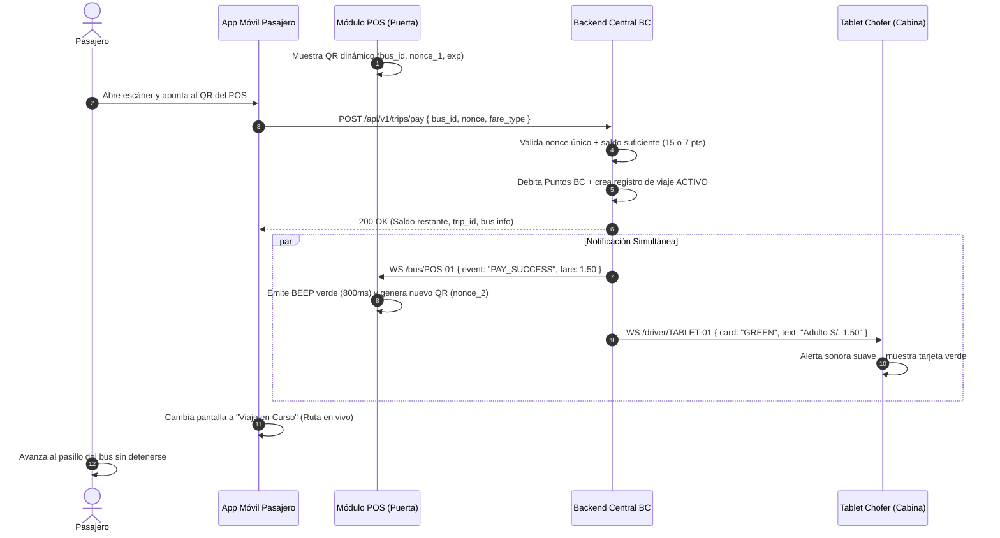

# Caso de Uso: CU-01 Abordaje y Pago con App en POS
**Ubicación:** `docs/casos_de_uso/CU01_Abordaje_Pago_App.md`  
**Módulos Involucrados:** App Móvil Pasajero, POS en Puerta, Tablet del Conductor, Backend BC  

---

## 1. Ficha del Caso de Uso

| Atributo | Detalle |
| :--- | :--- |
| **Identificador** | **CU-01** |
| **Nombre** | Abordaje y Pago con App en Módulo POS |
| **Actores** | Pasajero (Iniciador), POS Maestro en Bus, Conductor (Observador en Tablet), Backend BC |
| **Propósito** | Realizar el cobro del pasaje mediante descuento de Puntos BC de forma instantánea al subir al bus, emitiendo feedback visual y sonoro y suscribiendo al pasajero a la unidad. |
| **Precondiciones** | 1. El pasajero tiene la app instalada y sesión iniciada con saldo suficiente. 2. El POS del bus está encendido, conectado a 4G y mostrando un QR dinámico válido. 3. La tablet del chofer está vinculada a la sesión del bus. |
| **Disparador** | El pasajero abre la cámara de escaneo en la App BC y enfoca el QR dinámico de la pantalla del POS al subir por la puerta delantera. |

---

## 2. Flujo Principal (Camino Feliz)

### Paso a paso:
1. El POS muestra en su pantalla un código QR dinámico de un solo uso con identificador de bus y token aleatorio (`nonce`).
2. El pasajero sube al bus, abre la app y escanea el QR del POS.
3. La app envía la solicitud de cobro al backend con las credenciales del usuario y el payload del QR.
4. El backend verifica:
   * Que el `nonce` no haya sido utilizado previamente.
   * Que el usuario cuente con saldo igual o superior a la tarifa correspondiente (15 puntos para adulto o 7 si tiene beneficio universitario vigente).
5. El backend descuenta los puntos del monedero del usuario, registra la transacción en el libro contable e inicializa la sesión de viaje en estado `ACTIVO`.
6. De forma simultánea y en menos de 800 ms:
   * **En la App:** La pantalla pasa a modo *"Viaje en Curso"*, mostrando la ruta y el bus en movimiento.
   * **En el POS:** La pantalla se ilumina en verde, emite un tono auditivo `BEEP` de aprobación y regenera inmediatamente un nuevo QR para la siguiente persona.
   * **En la Tablet del Chofer:** Se despliega una tarjeta de confirmación visual grande (Verde o Amarilla) con un sonido sutil de paso.
7. El pasajero avanza al interior del bus.

---

## 3. Flujos Alternativos y Excepciones

### 3.1. Flujo Alternativo A: Saldo Insuficiente
* **Condición:** El usuario tiene menos de 15 puntos (o menos de 7 si es estudiante).
* **Comportamiento:**
  1. El backend rechaza la transacción con código `402 Payment Required` (`INSUFFICIENT_FUNDS`).
  2. La app del pasajero vibra y muestra en rojo: *"Saldo insuficiente. Tienes X puntos. Recarga ahora o paga con Yape directo"*.
  3. El POS emite un **doble tono grave (BEEP-BEEP)** y la pantalla muestra una advertencia en rojo por 1 segundo antes de volver al QR.
  4. La tablet del chofer muestra tarjeta roja: *"🔴 Saldo Insuficiente - NO PASA"*.
  5. El chofer solicita al usuario pagar mediante Yape directo o apartarse para recargar.

### 3.2. Flujo Alternativo B: Pago con Tarifa Universitaria y Cooldown Antifraude
* **Condición:** El usuario tiene perfil universitario activo.
* **Comportamiento:**
  1. El sistema descuenta 7 puntos (S/. 0.70).
  2. La tablet del chofer despliega tarjeta amarilla: *"🟡 Universitario (S/. 0.70)"*.
  3. El backend activa un temporizador de **bloqueo de tarifa reducida por 120 segundos** para esa cuenta. Si el usuario intenta escanear nuevamente dentro de los 2 minutos, el sistema solo le permite liquidar a tarifa adulto (15 puntos).

### 3.3. Flujo Alternativo C: Pago Multipersona (Viaje con Acompañantes)
* **Condición:** El usuario presiona el botón `[+]` en su app antes de escanear para pagar por 1 o más acompañantes.
* **Comportamiento:**
  1. Si es estudiante: se cobra 1 pasaje universitario (7 pts) + $N$ pasajes generales (15 pts c/u).
  2. Si es adulto: se cobran $N$ pasajes generales (15 pts c/u).
  3. El POS y la tablet reflejan la cantidad total pagada (ej. *"Verde: 3 Pasajes Pagados - S/. 3.70"*).
  4. Pasan todos los acompañantes juntos.

### 3.4. Flujo Alternativo D: Escaneo de QR Expirado o Duplicado
* **Condición:** Dos personas escanean el mismo QR casi a la vez, o el QR superó los 30 segundos sin usarse.
* **Comportamiento:**
  1. El segundo escaneo recibe error `QR_ALREADY_USED` o `QR_EXPIRED`.
  2. La app del usuario le notifica: *"Código en pantalla actualizado. Por favor reintenta con el nuevo QR"*.
  3. El usuario enfoca el nuevo QR del POS y el pago se completa normalmente.

---

## 4. Postcondiciones
* Saldo de Puntos BC debitado y registrado en el libro contable.
* Pasajero suscrito a la unidad `bus_id` en el backend.
* Contador de aforo del bus incrementado en $+1$ (o $+N$ si fue multipersona).
* Trazabilidad completa de auditoría almacenada para la liquidación del chofer/empresa.

