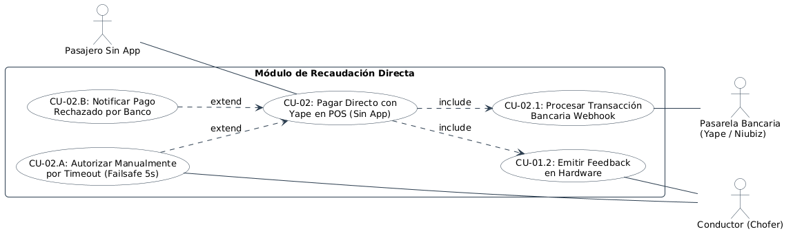
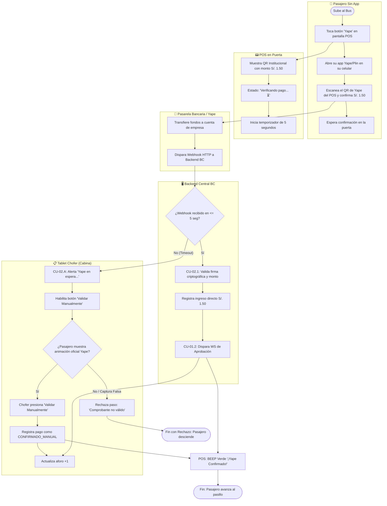

# Especificación Detallada de Caso de Uso: CU-02
## Pago Directo con Yape/Plin en POS (Sin App)
**Documento UML:** `docs/casos_de_uso/CU02_Pago_Yape_Directo_Sin_App.md`  
**Referencia UML:** `CU02` en [diagrama_casos_de_uso.puml](file:///Users/aron/githubRepo/sem-bus/docs/casos_de_uso/diagrama_casos_de_uso.puml)  
**Versión:** 2.0 (Análisis Riguroso)

---

## 1. Caracterización Formal del Caso de Uso

| Atributo | Definición Formal |
| :--- | :--- |
| **Identificador** | **CU-02** |
| **Nombre** | Pago Directo con Yape/Plin en Módulo POS (Usuario sin App) |
| **Nivel** | Subfunción / Flujo Alternativo de Recaudación en Puerta |
| **Actor Primario** | **Pasajero Sin App** (Usuario Ocasional) |
| **Actores Secundarios** | **Módulo POS en Puerta**, **Pasarela Bancaria Externa (Yape/Niubiz)**, **Tablet del Conductor**, **Backend BC** |
| **Partes Interesadas** | *Pasajero:* Desea viajar sin registrarse ni descargar una app nueva.<br>*Empresa de Transporte:* Asegura la recaudación digital sin manejo de monedas.<br>*Conductor:* Requiere validación certera para no ser víctima de capturas de pantalla falsas. |
| **Precondiciones** | 1. El POS tiene enlace 4G activo y suscripción a webhooks bancarios de la empresa.<br>2. El pasajero dispone de la app Yape/Plin en su smartphone con saldo bancario disponible. |
| **Postcondición de Éxito** | Se acreditan S/. 1.50 en la cuenta bancaria de la empresa de transporte, se incrementa el aforo (+1) y el POS emite tono de aprobación. |
| **Postcondición de Falla** | Tras 5 segundos sin confirmación ni validación visual del chofer, la transacción se cancela y el pasajero no aborda. |
| **Disparador** | El pasajero toca el botón táctil "Pagar con Yape" en el POS (o solicita al chofer pagar con Yape). |

---

## 2. Diagrama UML de Casos de Uso (Estructura y Relaciones)

<div align="center">
  
  <p><em>Figura: Diagrama UML 2.5 del Caso de Uso con Actores, Caso Base, relaciones &laquo;include&raquo; y &laquo;extend&raquo;.</em></p>
</div>

## 3. Puntos de Inclusión (`<<include>>`) y Extensión (`<<extend>>`)

### 2.1. Casos de Uso Incluidos (`<<include>>`)
* **`<<include>> CU-02.1` (Procesar Transacción Bancaria):** Recepción y verificación criptográfica de la notificación HTTP Webhook proveniente de la pasarela bancaria oficial (Niubiz/BCP).
* **`<<include>> CU-01.2` (Emitir Feedback en POS y Tablet):** Emisión síncrona del `BEEP` verde en el POS y la tarjeta verde en la tablet del chofer.

### 2.2. Puntos de Extensión (`<<extend>>`)

```
+---------------------------------------------------------------------------------------------------+
| PUNTO DE EXTENSIÓN 1: [PE-TIMEOUT-BANCO] (Retraso en Red Bancaria)                                |
|   Extendido por: CU-02.A (Autorización Manual del Conductor por Failsafe de 5s)                   |
|   Condición de Activación: tiempo_espera_webhook > 5.0 segundos                                   |
|   Regla Operativa: El chofer coteja el comprobante dinámico oficial de Yape en el celular del     |
|   usuario y pulsa [Validar Manualmente] para no retrasar el bus.                                  |
+---------------------------------------------------------------------------------------------------+
```

---

## 3. Diagrama de Actividades UML


 (Flujo de Decisiones)



---

## 4. Descripción Paso a Paso del Flujo

1. **[Interacción Inicial]:** El pasajero sin la app toca la pantalla del POS o solicita pagar con Yape.
2. **[POS]:** Muestra el código QR estático/dinámico institucional de Yape de la empresa de transporte, con el monto fijo pre-establecido de **S/. 1.50** y una referencia única: `REF-BUS01-TIMESTAMP`.
3. **[Pasajero]:** Abre su aplicación Yape en su teléfono, escanea el código, verifica el nombre de la empresa de transportes y confirma la transferencia de S/. 1.50.
4. **[POS]:** Entra en estado de escucha: *"Verificando pago... ⏳"* e inicia un temporizador de cuenta regresiva de 5.0 segundos.
5. **[Pasarela Bancaria - Inclusión CU-02.1]:**
   * El banco procesa la transferencia y envía un POST Webhook al backend con la firma criptográfica HMAC-SHA256:
     ```json
     POST /api/v1/webhooks/yape
     X-Signature: a8f5c7...
     {
       "transaction_id": "YAPE-9481729",
       "amount": 1.50,
       "reference": "REF-BUS01-TIMESTAMP",
       "status": "COMPLETED"
     }
     ```
6. **[Backend Central]:**
   * Valida la firma del banco para evitar inyecciones falsas.
   * Asocia la referencia con el `BUS_01` y registra la transacción en el libro mayor como `DIRECT_YAPE_PAYMENT`.
   * Envía señales síncronas al POS y a la tablet del chofer.
7. **[Hardware POS e Inclusión CU-01.2]:**
   * Emite el `BEEP` verde y despliega *"¡Yape Recibido! Pase"*.
   * Tras 1 segundo regresa a la pantalla principal de QR dinámico.
8. **[Tablet Conductor]:**
   * Muestra la tarjeta verde de cobro directo y suma $+1$ al aforo.
   * El pasajero sube al bus.

---

## 5. Extensión CU-02.A: Failsafe por Timeout Bancario (> 5 segundos)
* **Punto de Disparo:** Si pasan 5.0 segundos y el webhook no impactó en el backend debido a saturación en los servidores del BCP o intermitencia 4G.
* **Flujo de Contingencia:**
  1. El POS notifica a la tablet: `STATUS: WAITING_MANUAL_VERIFICATION`.
  2. La tablet del chofer emite un sonido característico y despliega en pantalla:  
     ⚠️ **"Yape demorado: Verifique comprobante en celular del pasajero"** con el botón de acción grande: **`[Validar Manualmente]`**.
  3. El chofer solicita al pasajero ver la pantalla de su teléfono.
  4. El chofer verifica los 3 elementos de autenticidad de Yape:
     * Animación de confirmación en movimiento (no captura estática).
     * Nombre de la empresa de transportes.
     * Hora exacta coincidente con el minuto actual.
  5. El chofer pulsa `[Validar Manualmente]`.
  6. La tablet asienta el pasaje como `MANUAL_OVERRIDE_PAID`, suma $+1$ al aforo y el POS emite el `BEEP` verde para que el pasajero ingrese de inmediato.
  7. Si el webhook llega más tarde (ej. a los 15 segundos), el backend hace conciliación automática asociando el webhook con el registro manual previo sin duplicar el aforo.
