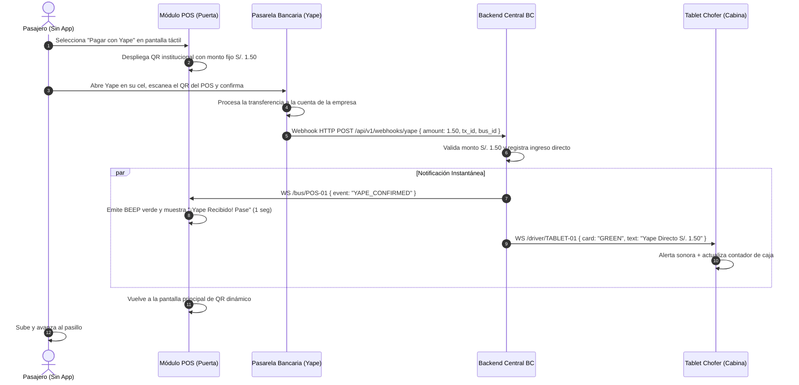

# Caso de Uso: CU-02 Pago Directo con Yape/Plin (Sin App)
**Ubicación:** `docs/casos_de_uso/CU02_Pago_Yape_Directo_Sin_App.md`  
**Módulos Involucrados:** POS en Puerta, Pasarela Bancaria (Yape/Niubiz), Tablet del Conductor, Backend BC  

---

## 1. Ficha del Caso de Uso

| Atributo | Detalle |
| :--- | :--- |
| **Identificador** | **CU-02** |
| **Nombre** | Pago Directo con Yape/Plin en POS (Sin App) |
| **Actores** | Pasajero Sin App (Iniciador), POS Maestro en Bus, Pasarela Bancaria Externa (Yape/BCP/Niubiz), Conductor (En Tablet), Backend BC |
| **Propósito** | Permitir que usuarios esporádicos o sin la App BC aborden el bus pagando S/. 1.50 directamente con su billetera bancaria habitual (Yape o Plin). |
| **Precondiciones** | 1. El POS tiene conexión 4G activa y está integrado a la API/webhook de la pasarela bancaria. 2. El pasajero dispone de saldo y conexión en su propia app bancaria (Yape o Plin). |
| **Disparador** | El pasajero toca el botón "Pagar con Yape/Plin" en la pantalla del POS (o el POS lo muestra en pantalla compartida). |

---

## 2. Flujo Principal (Camino Feliz)

---

## 3. Flujos Alternativos y Excepciones

### 3.1. Flujo Alternativo A: Demora de Red Bancaria (Failsafe de 5 Segundos)
* **Condición:** La red del banco o la cobertura local demora más de 5 segundos en emitir el webhook.
* **Comportamiento:**
  1. La pantalla del POS muestra: *"Verificando pago... ⏳"*.
  2. Al cumplirse 5 segundos sin confirmación automática, la tablet del chofer emite un aviso sonoro suave y despliega:  
     ⚠️ **"Yape en espera: ¿El pasajero muestra comprobante exitoso?"** con el botón **`[Validar Manualmente]`**.
  3. El pasajero muestra la pantalla verde de su celular con la animación oficial de Yape y la hora exacta al chofer.
  4. El chofer presiona `[Validar Manualmente]`.
  5. La tablet registra el pago en estado `CONFIRMADO_MANUAL`, incrementa el aforo del bus y el pasajero avanza sin detener la marcha del vehículo.

### 3.2. Flujo Alternativo B: Pago con Monto Erróneo o Rechazado por Banco
* **Condición:** El banco rechaza la transacción por fondos insuficientes en la cuenta del usuario o error en la app bancaria.
* **Comportamiento:**
  1. El celular del usuario muestra error en Yape.
  2. El POS no recibe confirmación y, tras el timeout, regresa al estado de espera.
  3. El pasajero debe reintentar o pagar con la App BC.

---

## 4. Postcondiciones
* Ingreso de S/. 1.50 registrado en la recaudación del bus y del turno del chofer.
* Contador de aforo del bus incrementado en $+1$.
* Sin suscripción digital de ruta (el usuario no tiene la App BC instalada).

