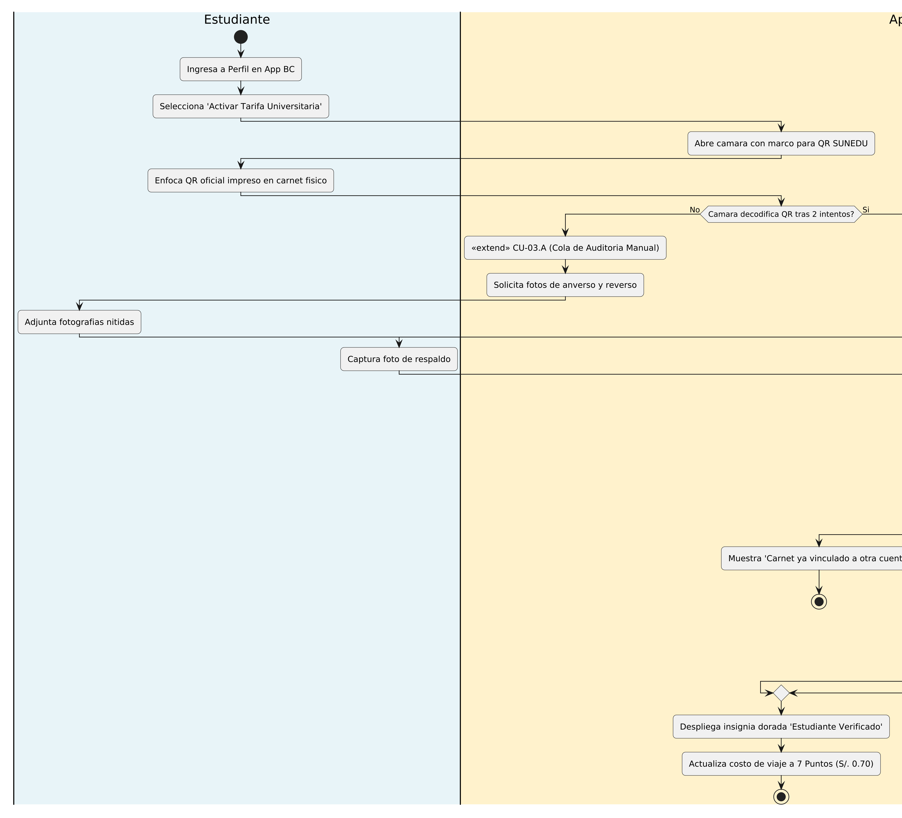
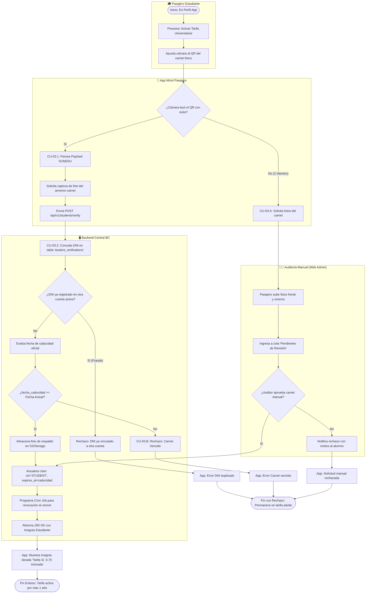

# Especificación Detallada de Caso de Uso: CU-03
## Acreditación de Carnet Universitario (SUNEDU)
**Documento UML:** `docs/casos_de_uso/CU03_Acreditacion_Carnet_SUNEDU.md`  
**Referencia UML:** `CU03` en [diagrama_casos_de_uso.puml](file:///Users/aron/githubRepo/sem-bus/docs/casos_de_uso/diagrama_casos_de_uso.puml)  
**Versión:** 2.0 (Análisis Riguroso)

---

## 1. Caracterización Formal del Caso de Uso

| Atributo | Definición Formal |
| :--- | :--- |
| **Identificador** | **CU-03** |
| **Nombre** | Acreditación y Validación de Tarifa Universitaria con QR SUNEDU |
| **Nivel** | Proceso de Soporte / Gestión de Beneficios Tarifarios |
| **Actor Primario** | **Pasajero Estudiante Universitario** |
| **Actores Secundarios** | **Servicio de Validación SUNEDU**, **Administrador de Transporte (Auditor)**, **Sistema Backend BC** |
| **Partes Interesadas** | *Estudiante:* Obtener la tarifa preferencial legal (S/. 0.70 por viaje).<br>*Empresa de Transporte:* Asegurar que solo estudiantes con carnet legítimo y vigente gocen del descuento, evitando fraudes de carnets prestados o falsificados. |
| **Precondiciones** | El usuario tiene cuenta activa en la App BC. Dispone del carnet universitario físico emitido por SUNEDU. |
| **Postcondición de Éxito** | El rol de la cuenta se actualiza a `STUDENT`, se programa la fecha de caducidad automática del beneficio y se habilita la tarifa de 7 Puntos BC. |
| **Postcondición de Falla** | La cuenta permanece en rol `ADULT` (tarifa 15 puntos) con notificación detallada de la causa de rechazo. |
| **Disparador** | El estudiante selecciona *"Vincular Carnet Universitario"* en su perfil de la App BC. |

---

## 2. Diagrama UML de Casos de Uso (Estructura y Relaciones)

<div align="center">
  
  <p><em>Figura: Diagrama UML 2.5 del Caso de Uso con Actores, Caso Base, relaciones &laquo;include&raquo; y &laquo;extend&raquo;.</em></p>
</div>

## 3. Puntos de Inclusión (`<<include>>`) y Extensión (`<<extend>>`)

### 2.1. Casos de Uso Incluidos (`<<include>>`)
* **`<<include>> CU-03.1` (Decodificar y Validar QR Oficial SUNEDU):** Lectura del formato criptográfico oficial impreso en el carnet, extrayendo DNI, universidad y fecha de caducidad.
* **`<<include>> CU-03.2` (Verificar Unicidad de DNI en Sistema):** Consulta a la base de datos para garantizar que ese DNI no esté registrado en otra cuenta activa.

### 2.2. Puntos de Extensión (`<<extend>>`)

```
+---------------------------------------------------------------------------------------------------+
| PUNTO DE EXTENSIÓN 1: [PE-CALIDAD-QR] (Carnet Deteriorado o Ilegible)                              |
|   Extendido por: CU-03.A (Derivar a Cola de Auditoría Manual Web)                                 |
|   Condición de Activación: La cámara falla al decodificar el QR tras 2 intentos consecutivos.     |
+---------------------------------------------------------------------------------------------------+
| PUNTO DE EXTENSIÓN 2: [PE-VIGENCIA] (Carnet Vencido en Fecha)                                     |
|   Extendido por: CU-03.B (Rechazar por Caducidad Vencida)                                         |
|   Condición de Activación: fecha_caducidad_sunedu < fecha_actual                                  |
+---------------------------------------------------------------------------------------------------+
```

---

## 3. Diagrama de Actividades UML


 (Flujo de Decisiones)



---

## 4. Descripción Paso a Paso del Flujo

1. **[Inicio]:** El estudiante accede a la pestaña de perfil en la App BC y selecciona el banner *"Activar Tarifa Universitaria (S/. 0.70)"*.
2. **[Lectura de QR - Inclusión CU-03.1]:**
   * La app activa la cámara con un visor específico para el formato QR de SUNEDU.
   * El estudiante enfoca el código QR ubicado al dorso del carnet.
   * La app decodifica la cadena oficial:
     ```
     SUNEDU|DNI:74819201|UNIV:UNJBG|ALUMNO:QUISPE MAMANI ARON|VENC:30/04/2027
     ```
3. **[Captura de Evidencia]:** La app solicita inmediatamente una fotografía nítida del anverso del carnet físico (donde se visualiza el rostro y nombre del estudiante).
4. **[Envío Seguro al Backend]:** La app empaqueta la información y la fotografía en base64:
   ```json
   POST /api/v1/students/verify
   {
     "dni": "74819201",
     "university": "UNJBG",
     "expires_at": "2027-04-30T23:59:59Z",
     "card_photo": "data:image/jpeg;base64,..."
   }
   ```
5. **[Verificación de Unicidad - Inclusión CU-03.2]:**
   * El backend busca en la base de datos: `SELECT user_id FROM student_verifications WHERE dni = '74819201' AND status = 'ACTIVE'`.
   * Si ya existe un registro con un `user_id` diferente, aborta la operación con `409 Conflict: STUDENT_CARD_ALREADY_REGISTERED`.
6. **[Validación de Caducidad con Prórroga Oficial SUNEDU]:**
   * El backend evalúa la fecha oficial del plástico sumando el parámetro global configurable:  
     `fecha_limite = expires_at + INTERVAL 'extension_gracia_dias' DAY`.  
     *(Permite que, ante decretos de prórroga oficial de SUNEDU en Perú, el administrador configure 30 o 60 días adicionales sin que los estudiantes pierdan su beneficio).*
   * Si `NOW() > fecha_limite`, activa la extensión **CU-03.B** y rechaza la postulación.
7. **[Activación del Beneficio]:**
   * Actualiza el perfil del usuario: `role = 'STUDENT'`, `student_expires_at = '2027-04-30'`.
   * Registra la evidencia en el bucket de almacenamiento seguro.
   * Programa una tarea diferida (cron job) para el día `2027-05-01` a las 00:00 para revertir automáticamente el rol a `ADULT`.
8. **[Confirmación]:** La app despliega una animación de éxito con la insignia dorada *"Estudiante Verificado"* y en su monedero se actualiza el costo por pasaje a **7 Puntos BC (S/. 0.70)**.
