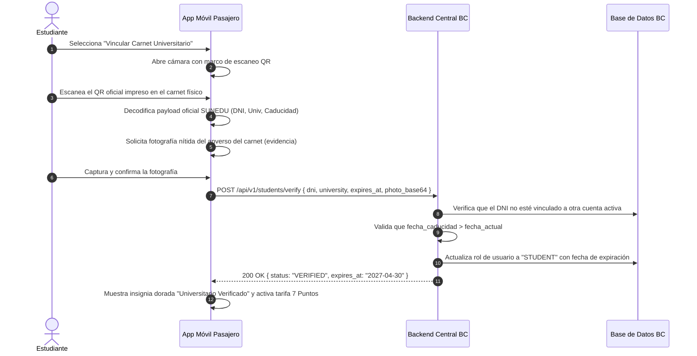

# Caso de Uso: CU-03 Acreditación de Carnet Universitario (SUNEDU)
**Ubicación:** `docs/casos_de_uso/CU03_Acreditacion_Carnet_SUNEDU.md`  
**Módulos Involucrados:** App Móvil Pasajero, Backend Central BC, Base de Datos SUNEDU / Servicio de Validación  

---

## 1. Ficha del Caso de Uso

| Atributo | Detalle |
| :--- | :--- |
| **Identificador** | **CU-03** |
| **Nombre** | Acreditación de Tarifa Universitaria mediante Carnet SUNEDU |
| **Actores** | Pasajero Estudiante (Iniciador), Backend BC, Administrador de Transporte (Revisor en caso de contingencia) |
| **Propósito** | Validar la condición de estudiante universitario de forma automatizada mediante el QR oficial de SUNEDU para habilitar la tarifa preferencial de S/. 0.70 (7 Puntos BC) con vigencia máxima de 1 año. |
| **Precondiciones** | El usuario tiene una cuenta registrada en la App BC con su número de teléfono. Dispone de su carnet universitario físico oficial emitido por SUNEDU. |
| **Disparador** | El usuario selecciona *"Activar Tarifa Universitaria"* en la sección de perfil de la App BC. |

---

## 2. Flujo Principal (Camino Feliz)

---

## 3. Flujos Alternativos y Excepciones

### 3.1. Flujo Alternativo A: Carnet ya Registrado en Otra Cuenta (Antifraude)
* **Condición:** El DNI extraído del QR ya está asociado a otra cuenta activa de la App BC.
* **Comportamiento:**
  1. El backend bloquea el registro con código `409 Conflict` (`STUDENT_ID_ALREADY_IN_USE`).
  2. La app informa: *"Este carnet universitario ya está vinculado a otro número de teléfono. Si perdiste tu número anterior, solicita soporte para desvincularlo"*.
  3. No se activa el beneficio.

### 3.2. Flujo Alternativo B: Carnet Caducado
* **Condición:** La fecha de expiración codificada en el QR es anterior a la fecha actual.
* **Comportamiento:**
  1. El backend rechaza la solicitud: `422 Unprocessable Entity` (`STUDENT_CARD_EXPIRED`).
  2. La app informa: *"Tu carnet universitario figura como vencido ante SUNEDU. Debes tramitar la renovación con tu universidad"*.
  3. La cuenta permanece en tarifa general (15 puntos).

### 3.3. Flujo Alternativo C: QR Deteriorado o No Legible (Revisión Manual)
* **Condición:** El carnet físico está rayado y la cámara no puede decodificar el QR.
* **Comportamiento:**
  1. Tras 2 intentos fallidos, la app ofrece: *"¿Problemas para escanear? Subir fotos para revisión manual"*.
  2. El usuario adjunta foto del frente y reverso del carnet.
  3. La solicitud ingresa a una bandeja de auditoría en el panel administrativo web.
  4. El administrador aprueba o rechaza en menos de 24 horas.

---

## 4. Postcondiciones
* Perfil del usuario actualizado con rol `STUDENT`.
* Tarifa por pasaje reducida a 7 Puntos BC (S/. 0.70).
* Tarea programada registrada en el backend para revertir la cuenta a tarifa general al vencer la fecha de caducidad.

