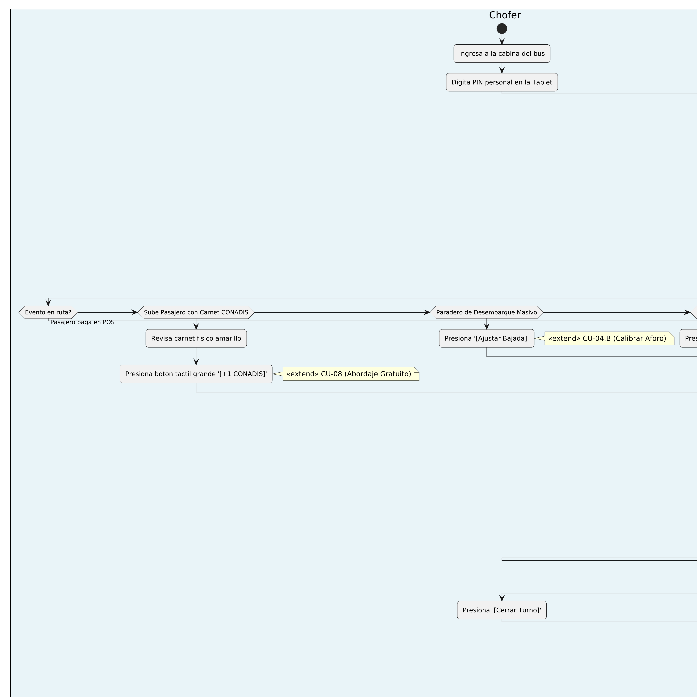
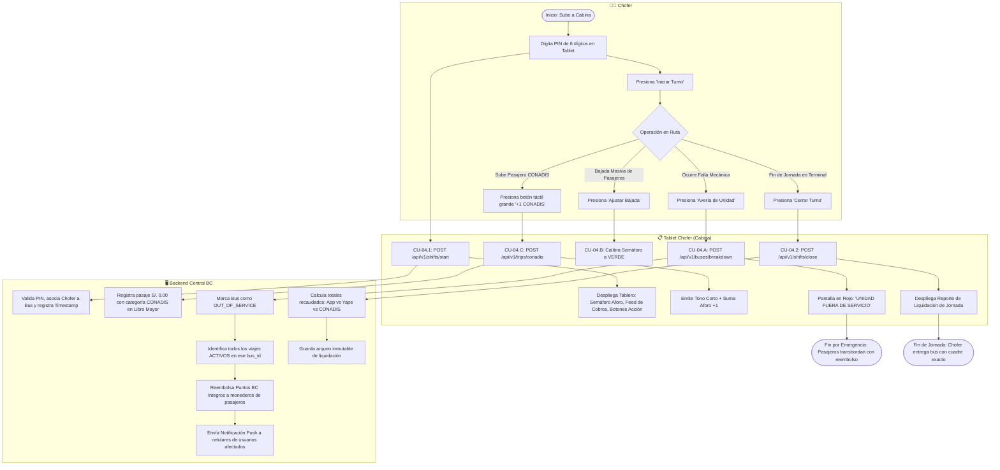

# Especificación Detallada de Caso de Uso: CU-04
## Operación de Turno y Control en Tablet del Conductor
**Documento UML:** `docs/casos_de_uso/CU04/CU04_Operacion_Turno_Conductor_Tablet.md`  
**Referencia UML:** `CU04` en [diagrama_casos_de_uso.puml](file:///Users/aron/githubRepo/sem-bus/docs/casos_de_uso/diagrama_casos_de_uso.puml)  
**Versión:** 2.0 (Análisis Riguroso)

---

## 1. Caracterización Formal del Caso de Uso

| Atributo | Definición Formal |
| :--- | :--- |
| **Identificador** | **CU-04** |
| **Nombre** | Operación de Turno de Conducción y Monitoreo de Cabina en Tablet |
| **Nivel** | Proceso de Negocio / Operación de Flota |
| **Actor Primario** | **Conductor / Chofer del Bus** |
| **Actores Secundarios** | **Módulo POS en Puerta**, **Sistema Backend BC**, **Pasajeros a Bordo** |
| **Partes Interesadas** | *Conductor:* Monitorear que todos paguen sin distraer la vista del camino, registrar CONADIS y tener su liquidación clara al final del día.<br>*Empresa de Transporte:* Auditar kilómetros, horas de conducción, puntualidad de paraderos y recaudación real por chofer.<br>*Pasajeros con Discapacidad:* Acceso ágil y digno al transporte gratuito garantizado por ley. |
| **Precondiciones** | La tablet del chofer está anclada al tablero del bus, con alimentación de energía y conectada al backend vía 4G o Wi-Fi local con el POS. |
| **Postcondición de Éxito** | Turno aperturado, supervisado y liquidado con informe consolidado de pasajes App, Yape y CONADIS en el backend. |
| **Postcondición de Falla** | Si se declara avería o fin anticipado forzoso, el bus sale de servicio y se reembolsan los viajes a los pasajeros afectados. |
| **Disparador** | El chofer sube a la cabina al iniciar su jornada y digita su PIN personal en la pantalla táctil de la tablet. |

---

## 2. Diagrama UML de Casos de Uso (Estructura y Relaciones)

<div align="center">
  
  <p><em>Figura: Diagrama UML 2.5 del Caso de Uso con Actores, Caso Base, relaciones &laquo;include&raquo; y &laquo;extend&raquo;.</em></p>
</div>

## 3. Puntos de Inclusión (`<<include>>`) y Extensión (`<<extend>>`)

### 3.1. Casos de Uso Incluidos (`<<include>>`)
* **`<<include>> CU-04.1` (Autenticar Chofer por PIN):** Validación de identidad del conductor y vinculación al `bus_id` asignado para la jornada.
* **`<<include>> CU-04.2` (Liquidar y Generar Reporte de Arqueo):** Consolidación contable al cierre de turno, desglosando recaudación por App, Yape directo y gratuidad CONADIS.

### 3.2. Puntos de Extensión (`<<extend>>`)

```
+---------------------------------------------------------------------------------------------------+
| PUNTO DE EXTENSIÓN 1: [PE-CONADIS] (Abordaje de Pasajero con Discapacidad)                        |
|   Extendido por: CU-04.C (Registrar Abordaje Gratuito CONADIS S/. 0.00)                           |
|   Condición de Activación: Pasajero exhibe carnet amarillo oficial de CONADIS al subir.          |
+---------------------------------------------------------------------------------------------------+
| PUNTO DE EXTENSIÓN 2: [PE-EMERGENCIA] (Desperfecto Mecánico o Accidente en Ruta)                  |
|   Extendido por: CU-04.A (Declarar Avería Mecánica y Disparar Reembolso Automático a Pasajeros)   |
|   Condición de Activación: Chofer presiona el botón de pánico/avería ante imposibilidad de seguir.|
+---------------------------------------------------------------------------------------------------+
| PUNTO DE EXTENSIÓN 3: [PE-AFORO-CALIB] (Desembarque Masivo en Paradero)                           |
|   Extendido por: CU-04.B (Calibrar Semáforo de Aforo a Estado 'Asientos Libres')                  |
|   Condición de Activación: Paradero terminal/universitario donde desciende gran volumen de gente. |
+---------------------------------------------------------------------------------------------------+
```

---

## 3. Diagrama de Actividades UML


 (Flujo de Decisiones)



---

## 4. Descripción Paso a Paso del Flujo

### 4.1. Apertura de Turno (CU-04.1)
1. El chofer enciende la tablet montada en el tablero.
2. Ingresa su PIN de 6 dígitos.
3. La tablet envía la solicitud al backend:
   ```json
   POST /api/v1/shifts/start
   {
     "driver_id": "DRV-102",
     "bus_id": "BUS_01",
     "initial_km": 142580
   }
   ```
4. El backend valida el PIN, desactiva turnos anteriores pendientes y responde con la ruta asignada (ej. *"Línea 10: Cono Norte - Terminal Terrestre"*).
5. La tablet despliega el tablero de mandos en modo nocturno/diurno de alto contraste.

### 4.2. Operación de Monitoreo en Ruta y Gestión de Sentido
* Cada vez que un pasajero paga por el POS (con la App o Yape directo), la tablet reproduce un sonido discreto y muestra un banner gigante durante 3 segundos:
  * 🟢 **"Pasaje Adulto: S/. 1.50"**
  * 🟡 **"Pasaje Universitario: S/. 0.70"**
* Si un cobro falla, suena una alerta y muestra:
  * 🔴 **"Saldo Insuficiente - NO PASA"**
* El semáforo de aforo en la esquina superior derecha se actualiza automáticamente.
* **Cambio Automático de Sentido (Ida ↔ Vuelta):**  
  Al llegar al paradero de retorno o terminal de cabecera, la tablet invierte automáticamente el sentido de la ruta (*"Sentido Subida"* pasa a *"Sentido Bajada"*), actualizando la secuencia de paraderos y tiempos estimados en los mapas de los usuarios.

### 4.3. Extensión CU-04.C: Inhabilitar Unidad en Mapa Público por Incidencia Menor
* **Condición de Disparo:** Se pincha una llanta, hay recalentamiento leve o el chofer debe apartarse temporalmente de la ruta.
* **Comportamiento:**
  1. El chofer presiona el interruptor en la tablet: **`[Pausar en Mapa Público]`**.
  2. La unidad se vuelve **invisible para los pasajeros en la app** (así nadie espera un bus varado).
  3. La unidad **sigue 100% visible y monitoreada en tiempo real para el Administrador** en el Panel Web de Gestión de Flota.
  4. Una vez reparada la incidencia, el chofer reactiva el interruptor y el bus reaparece en el mapa público de los pasajeros.

### 4.4. Extensión CU-04.C: Registro de Pasajero CONADIS ([PE-CONADIS])
1. Un pasajero con discapacidad muestra su carnet amarillo físico de CONADIS al chofer.
2. El chofer pulsa el botón táctil de gran tamaño: **`[+1 CONADIS]`**.
3. La tablet emite un tono corto de registro y envía la transacción a tarifa **S/. 0.00**.
4. El aforo se incrementa en $+1$ para mantener la exactitud de pasajeros a bordo.

### 4.5. Extensión CU-04.A: Declaración de Avería Mecánica ([PE-EMERGENCIA])
1. Ocurre una falla crítica (neumático reventado, sobrecalentamiento).
2. El chofer presiona el botón rojo **`[Reportar Avería]`** y confirma el pop-up de seguridad.
3. El backend:
   * Pasa el bus a estado inactivo en el mapa público para que ningún usuario en paraderos lo espere.
   * Ejecuta la consulta: `SELECT user_id, amount_points FROM trips WHERE bus_id = 'BUS_01' AND status = 'ACTIVE'`.
   * Reembolsa los puntos inmediatamente a cada usuario en el monedero (`REVERT_TRIP_BREAKDOWN`).
   * Despacha notificaciones push a los celulares de los usuarios a bordo: *"Tu bus ha reportado una falla técnica. Tu pasaje ha sido reembolsado íntegramente"*.
4. El chofer indica a los pasajeros que pueden descender o transbordar.

### 4.6. Cierre de Turno y Liquidación (CU-04.2)
1. Al terminar la jornada en el terminal de la empresa, el chofer presiona **`[Cerrar Turno]`**.
2. La tablet solicita el kilometraje final y confirma el cierre.
3. El backend genera el comprobante digital de liquidación:
   * **Total de Pasajeros:** 342 personas.
   * **Pagos con App BC:** 215 pasajes (S/. 298.50 en Puntos BC).
   * **Pagos con Yape Directo:** 112 pasajes (S/. 168.00 bancarizados).
   * **Pasajeros CONADIS:** 15 personas (S/. 0.00).
   * **Total Recaudado:** S/. 466.50.
4. El chofer confirma el arqueo e ingresa su PIN de 6 dígitos para finalizar el turno y cerrar su sesión.

---

## 5. Criterios de Aceptación para QA (Escenarios BDD / Cucumber)

```gherkin
Feature: Operación de Turno en Tablet del Conductor
  Como chofer del transporte urbano
  Quiero operar mi turno de conducción desde la tablet de cabina
  Para supervisar los cobros de pasajeros, registrar gratuidades y liquidar mi jornada

  Scenario: Inicio de turno exitoso con PIN de 6 dígitos
    Given que el chofer "DRV-10" sube a la cabina del "BUS_01"
    When digita su PIN de 6 dígitos e inicia turno con kilometraje 145200 km
    Then el backend valida las credenciales y crea un registro en "shifts" con estado "ACTIVE"
    And la tablet despliega la interfaz de cabina con el semáforo de aforo y sentido inicial "SUBIDA"

  Scenario: Registro de pasajero con carnet CONADIS (Pase Gratuito S/. 0.00)
    Given que un pasajero con discapacidad muestra su carnet amarillo físico de CONADIS
    When el chofer presiona el botón táctil grande "+1 CONADIS"
    Then la tablet emite un tono corto de confirmación
    And registra la transacción a tarifa de S/. 0.00 en "shifts.total_conadis_count"
    And actualiza el aforo sumando +1 persona sin debitar dinero

  Scenario: Declaración de avería mecánica y reembolso masivo a pasajeros activos
    Given que el "BUS_01" sufre una falla de neumático con 18 pasajeros a bordo con viaje "ACTIVE"
    When el chofer presiona "Reportar Avería" y confirma la ventana de seguridad
    Then el backend marca el bus como "OUT_OF_SERVICE" y lo oculta en el mapa público
    And ejecuta la devolución automática del 100% de los puntos a los 18 pasajeros en sus monederos
    And despacha una notificación push de aviso a los smartphones de los usuarios afectados

  Scenario: Cierre de turno y liquidación consolidada
    Given que el chofer finaliza su recorrido en el paradero terminal
    When presiona "Cerrar Turno" e ingresa el kilometraje final 145340 km
    Then el backend calcula el arqueo segregado: recaudación App BC, recaudación Yape y viajes CONADIS
    And cierra el turno con estado "COMPLETED" en la tabla "shifts"
```
