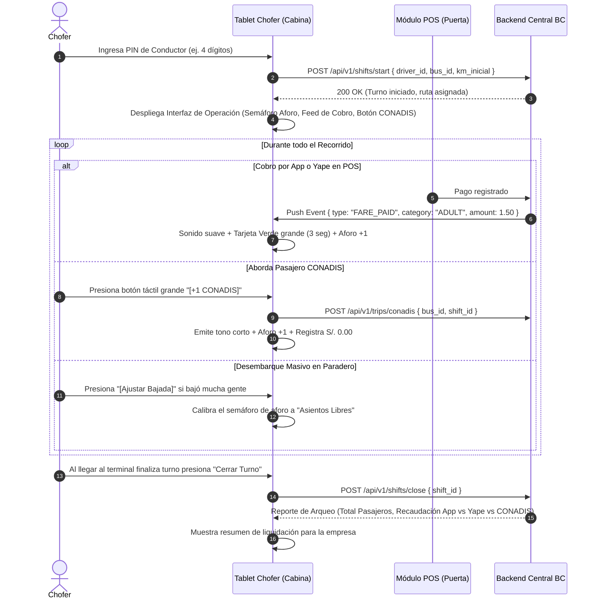

# Caso de Uso: CU-04 Operación de Turno y Control (Tablet Conductor)
**Ubicación:** `docs/casos_de_uso/CU04_Operacion_Turno_Conductor_Tablet.md`  
**Módulos Involucrados:** Tablet del Conductor, POS Maestro en Bus, Backend Central BC  

---

## 1. Ficha del Caso de Uso

| Atributo | Detalle |
| :--- | :--- |
| **Identificador** | **CU-04** |
| **Nombre** | Operación de Turno y Monitoreo de Cabina en Tablet del Chofer |
| **Actores** | Conductor (Iniciador), Tablet del Chofer, POS en Puerta, Backend BC |
| **Propósito** | Gestionar la apertura y cierre de jornada laboral del chofer, monitorear los abordajes en tiempo real sin desviar la atención del volante, registrar pasajeros CONADIS y cuadrar la recaudación de la jornada. |
| **Precondiciones** | La tablet está montada en el tablero del bus, con alimentación eléctrica y conexión a internet (4G o Wi-Fi directo con el POS). |
| **Disparador** | El conductor inicia su jornada laboral ingresando su PIN de conductor en la tablet. |

---

## 2. Flujo Principal (Camino Feliz)

---

## 3. Flujos Alternativos y Excepciones

### 3.1. Flujo Alternativo A: Reporte de Avería Mecánica / Emergencia en Ruta
* **Condición:** El bus sufre un desperfecto (pinchazo de llanta, falla de motor) o accidente y no puede completar el recorrido.
* **Comportamiento:**
  1. El chofer presiona el botón rojo: **`[Reportar Avería de Unidad]`**.
  2. La tablet solicita confirmación con 1 toque.
  3. El backend marca la unidad como `FUERA_DE_SERVICIO`.
  4. **Reembolso automático:** El backend identifica a todos los pasajeros que tenían viaje activo en ese `bus_id` y les reembolsa el costo de su pasaje en Puntos BC de inmediato.
  5. Los pasajeros reciben notificación push: *"Tu unidad ha reportado un desperfecto. Tus puntos han sido devueltos automáticamente"*.

### 3.2. Flujo Alternativo B: Relevo de Conductor (Cambio de Chofer)
* **Condición:** Termina el turno de la mañana y sube un chofer de relevo en el mismo bus.
* **Comportamiento:**
  1. Chofer 1 presiona *"Cerrar Turno"*. La tablet genera su reporte personal.
  2. Chofer 2 ingresa su propio PIN sin necesidad de reiniciar el POS ni el bus.
  3. Las estadísticas y recaudación de cada chofer quedan auditadas de forma independiente en la base de datos.

---

## 4. Postcondiciones
* Registro exacto de horas de operación y kilómetros recorridos por conductor.
* Cuadre de recaudación digital (Puntos BC canjeables vs transferencias bancarias de Yape).
* Historial de aforo y ocupación por paradero para optimización de frecuencias de buses.

