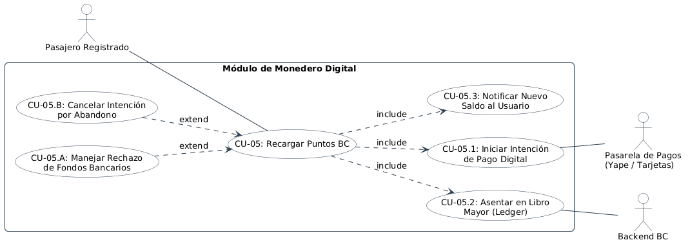
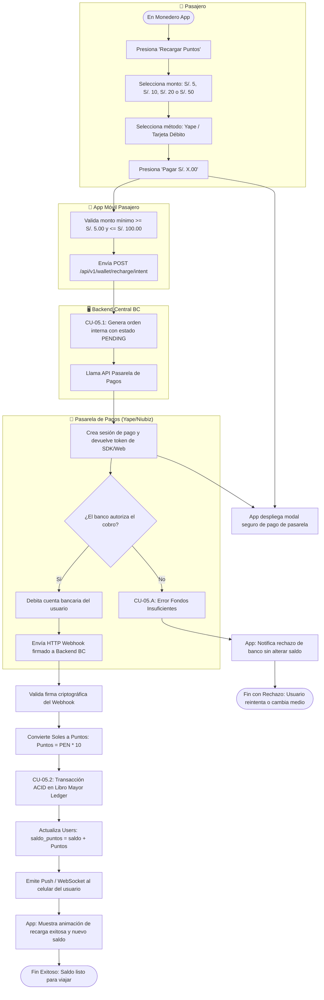

# Especificación Detallada de Caso de Uso: CU-05
## Recarga de Puntos BC mediante Pasarela Digital
**Documento UML:** `docs/casos_de_uso/CU05/CU05_Recarga_Puntos_BC.md`  
**Referencia UML:** `CU05` en [diagrama_casos_de_uso.puml](file:///Users/aron/githubRepo/sem-bus/docs/casos_de_uso/diagrama_casos_de_uso.puml)  
**Versión:** 2.0 (Análisis Riguroso)

---

## 1. Caracterización Formal del Caso de Uso

| Atributo | Definición Formal |
| :--- | :--- |
| **Identificador** | **CU-05** |
| **Nombre** | Recarga de Puntos BC mediante Pasarela Digital |
| **Nivel** | Objetivo de Usuario / Gestión Financiera de Monedero |
| **Actor Primario** | **Pasajero Registrado** |
| **Actores Secundarios** | **Pasarela de Pagos Externa (Yape / Plin / Tarjetas)**, **Sistema Backend BC** |
| **Partes Interesadas** | *Pasajero:* Disponer de saldo suficiente para viajar sin depender de efectivo.<br>*Empresa de Transporte:* Anticipación de flujo de caja (prepago de pasajes) y reducción de manipulación de billetes. |
| **Precondiciones** | El usuario tiene sesión activa en la App BC. Dispone de saldo en su cuenta de ahorros bancaria o billetera digital Yape/Plin. |
| **Postcondición de Éxito** | Se acreditan los Puntos BC según la tasa fija (S/. 1.00 = 10 Pts), se inserta el asiento en `ledger_transactions` y el saldo está listo para usarse. |
| **Postcondición de Falla** | No se debitan fondos bancarios, la orden de recarga expira y el saldo de puntos previo permanece inalterado. |
| **Disparador** | El pasajero presiona el botón *"Recargar Puntos"* en el monedero de la app. |

---

## 2. Diagrama UML de Casos de Uso (Estructura y Relaciones)

<div align="center">
  
  <p><em>Figura: Diagrama UML 2.5 del Caso de Uso con Actores, Caso Base, relaciones &laquo;include&raquo; y &laquo;extend&raquo;.</em></p>
</div>

## 3. Puntos de Inclusión (`<<include>>`) y Extensión (`<<extend>>`)

### 3.1. Casos de Uso Incluidos (`<<include>>`)
* **`<<include>> CU-05.1` (Iniciar Intención de Pago Digital):** Creación de la orden transaccional con la pasarela bancaria y obtención del token/referencia de pago.
* **`<<include>> CU-05.2` (Asentar en Libro Mayor - Ledger):** Registro contable inmutable con `balance_before`, `amount_credit` y `balance_after`.

### 3.2. Puntos de Extensión (`<<extend>>`)

```
+---------------------------------------------------------------------------------------------------+
| PUNTO DE EXTENSIÓN 1: [PE-RECHAZO-BANCO] (Fallo en la Transacción Bancaria)                        |
|   Extendido por: CU-05.A (Manejar Rechazo de Fondos Bancarios)                                     |
|   Condición de Activación: Pasarela bancaria retorna error por fondos insuficientes o timeout.   |
+---------------------------------------------------------------------------------------------------+
```

---

## 3. Diagrama de Actividades UML


 (Flujo de Decisiones)



---

## 4. Descripción Paso a Paso del Flujo

1. **[Selección de Monto]:** El usuario abre el monedero en la App BC y selecciona el importe en soles mediante botones rápidos (`S/. 5.00`, `S/. 10.00`, `S/. 20.00`, `S/. 50.00`) o ingresa un monto personalizado (mínimo S/. 5.00, máximo S/. 100.00).
2. **[Selección de Medio de Pago]:** Elige entre:
   * **Yape (Código de Aprobación):** Genera el código de 6 dígitos en Yape y lo ingresa en la app.
   * **Tarjeta Débito/Crédito:** Ingresa datos con tokenización segura PCI-DSS.
3. **[Creación de Intención - Inclusión CU-05.1]:**
   * La app despacha: `POST /api/v1/wallet/recharge/intent { "amount_pen": 10.00, "gateway": "YAPE" }`.
   * El backend crea un registro en tabla `recharges` con estado `PENDING` y expira a los 10 minutos.
4. **[Procesamiento Bancario]:**
   * La pasarela procesa el cobro con el banco emisor.
   * Al completarse, la pasarela dispara un Webhook HTTP seguro hacia el endpoint del backend con firma HMAC-SHA256:
     ```json
     POST /api/v1/webhooks/recharges
     X-Signature: c81a94f...
     {
       "recharge_id": "REC-849102",
       "amount_pen": 10.00,
       "status": "APPROVED",
       "auth_code": "AUT-91820"
     }
     ```
5. **[Asiento en Libro Mayor - Inclusión CU-05.2]:**
   * El backend valida la firma del webhook para impedir falsificaciones.
   * Ejecuta la conversión de moneda: $\text{Puntos} = 10.00 \times 10 = 100\text{ Puntos BC}$.
   * En una transacción atómica:
     * Cambia el estado de la recarga a `COMPLETED`.
     * Inserta en `ledger_transactions` el tipo `RECHARGE_CREDIT`.
     * Incrementa `wallets.points_balance += 100` (mediante función atómica `fn_credit_wallet()`).
6. **[Notificación]:**
   * El backend emite un mensaje por WebSocket a la sesión del usuario.
   * La app vibra suavemente, reproduce un sonido de monedas y actualiza el saldo en pantalla: *"¡Recarga exitosa! +100 Puntos BC añadidos"*.


---

## 5. Criterios de Aceptación para QA (Escenarios BDD / Cucumber)

```gherkin
Feature: Recarga de Puntos BC mediante Pasarela Digital
  Como pasajero registrado
  Quiero recargar Puntos BC en mi monedero digital mediante Yape o tarjeta
  Para disponer de saldo suficiente y pagar mis pasajes en el bus

  Scenario: Recarga digital exitosa con conversión 1:10 (S/. 10.00 = 100 Puntos)
    Given que el usuario "U5" tiene un saldo previo de 15 Puntos BC
    When selecciona recargar S/. 10.00 mediante Yape
    And completa la autorización bancaria en la pasarela
    Then la pasarela emite un webhook firmado al backend
    And el backend asienta un crédito de 100 Puntos BC en "ledger_transactions"
    And actualiza el saldo en "wallets" a 115 Puntos BC
    And la app muestra la animación de recarga exitosa y nuevo saldo disponible

  Scenario: Rechazo de intento de recarga por monto inferior al mínimo permitido
    Given que el usuario intenta ingresar un monto personalizado de S/. 2.00
    When presiona el botón "Continuar"
    Then la app valida localmente la regla de negocio y bloquea el avance
    And muestra el mensaje de error "El monto mínimo de recarga es S/. 5.00 (50 Puntos BC)"

  Scenario: Idempotencia ante webhook de recarga repetido por latencia de pasarela
    Given que una orden de recarga "REC-849102" ya fue acreditada y marcada como "COMPLETED"
    When la pasarela de pagos retransmite el mismo webhook de confirmación
    Then el backend detecta el estado previo completado
    And no duplica los puntos en el monedero del usuario
    And responde HTTP 200 OK a la pasarela
```
