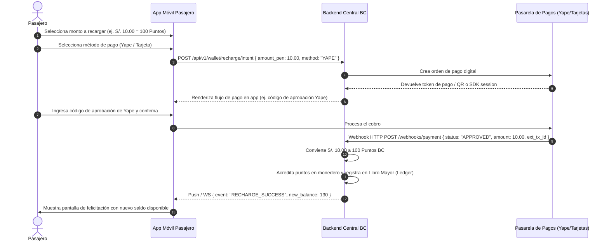

# Caso de Uso: CU-05 Recarga de Puntos BC
**Ubicación:** `docs/casos_de_uso/CU05_Recarga_Puntos_BC.md`  
**Módulos Involucrados:** App Móvil Pasajero, Pasarela de Pagos Digital (Culqi / Niubiz / MercadoPago), Backend BC  

---

## 1. Ficha del Caso de Uso

| Atributo | Detalle |
| :--- | :--- |
| **Identificador** | **CU-05** |
| **Nombre** | Recarga de Puntos BC mediante Pasarela Digital |
| **Actores** | Pasajero (Iniciador), Pasarela de Pagos (Yape / Plin / Tarjeta), Backend Central BC |
| **Propósito** | Acreditar Puntos BC en el monedero digital del usuario mediante el pago en soles con Yape, Plin o tarjetas de débito/crédito para permitir viajes futuros. |
| **Precondiciones** | El usuario tiene sesión iniciada en la App BC. Dispone de saldo en su cuenta bancaria o billetera digital. |
| **Disparador** | El usuario presiona el botón *"Recargar Puntos"* en la pantalla de inicio o monedero de la app. |

---

## 2. Flujo Principal (Camino Feliz)

---

## 3. Flujos Alternativos y Excepciones

### 3.1. Flujo Alternativo A: Rechazo por Fondos Insuficientes en el Banco
* **Condición:** La tarjeta bancaria o cuenta Yape del usuario no tiene fondos suficientes.
* **Comportamiento:**
  1. La pasarela bancaria retorna error `PAYMENT_DECLINED`.
  2. La App BC muestra: *"Tu banco no pudo procesar el pago. Por favor verifica tu saldo en Yape o intenta con otra tarjeta"*.
  3. No se acreditan puntos ni se generan cargos en el monedero.

### 3.2. Flujo Alternativo B: Abandono / Cancelación por el Usuario
* **Condición:** El usuario cierra la pantalla de pasarela antes de ingresar el código o confirmar.
* **Comportamiento:**
  1. La orden de recarga expira a los 10 minutos en el backend con estado `EXPIRED`.
  2. El saldo previo del usuario permanece inalterado.

---

## 4. Postcondiciones
* Saldo de Puntos BC incrementado de forma inmediata e inmutable.
* Comprobante digital de recarga almacenado en el historial de transacciones del usuario.
* Tasa de conversión respetada: 1 Sol = 10 Puntos BC.

