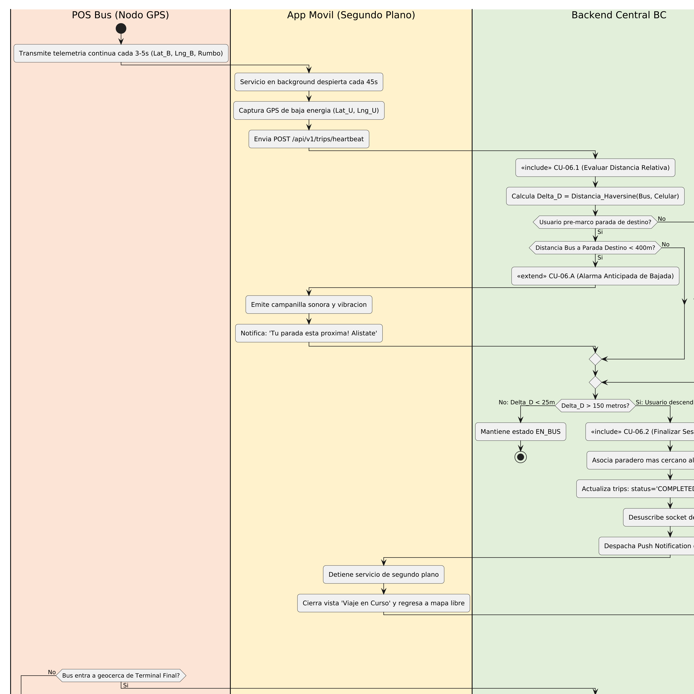
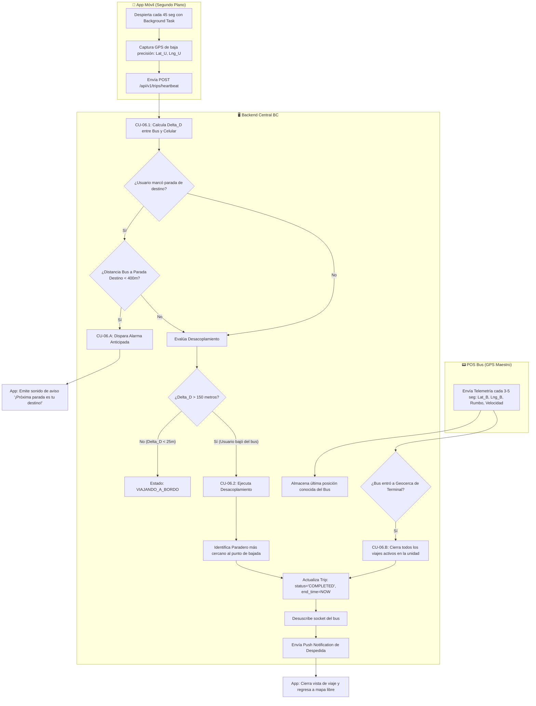

# Especificación Detallada de Caso de Uso: CU-06
## Descenso y Desacoplamiento por Geofencing
**Documento UML:** `docs/casos_de_uso/CU06_Descenso_Desacoplamiento_Geofencing.md`  
**Referencia UML:** `CU06` en [diagrama_casos_de_uso.puml](file:///Users/aron/githubRepo/sem-bus/docs/casos_de_uso/diagrama_casos_de_uso.puml)  
**Versión:** 2.0 (Análisis Riguroso)

---

## 1. Caracterización Formal del Caso de Uso

| Atributo | Definición Formal |
| :--- | :--- |
| **Identificador** | **CU-06** |
| **Nombre** | Detección de Descenso y Desuscripción de Ruta por Desacoplamiento GPS |
| **Nivel** | Proceso Automatizado del Sistema / Telemetría |
| **Actor Primario** | **Sistema Backend BC** (Orquestador Autónomo) |
| **Actores Secundarios** | **Pasajero** (Portador pasivo del smartphone), **Módulo POS** (Emisor de Coordenadas del Bus) |
| **Partes Interesadas** | *Pasajero:* Recibir una experiencia fluida sin tener que acordarse de presionar botones para bajarse del bus, cuidando su batería.<br>*Empresa de Transporte:* Conocer las matrices de Origen-Destino (dónde sube y dónde baja la gente) para optimizar recorridos. |
| **Precondiciones** | El usuario tiene un viaje en estado `ACTIVO` (tras completar CU-01). El POS del bus transmite telemetría 4G continua. |
| **Postcondición de Éxito** | El viaje se marca como `FINALIZADO`, se registra el paradero de bajada y se desuscribe la sesión del bus sin drenar la batería del usuario. |
| **Postcondición de Falla** | Si la app pierde señal o se apaga el teléfono, el viaje se finaliza de forma segura al llegar al terminal o tras 60 minutos sin penalidad para el usuario. |
| **Disparador** | El pasajero desciende físicamente en un paradero y la distancia física entre el bus y su smartphone supera el umbral de desacoplamiento de 150 metros. |

---

## 2. Puntos de Inclusión (`<<include>>`) y Extensión (`<<extend>>`)

### 2.1. Casos de Uso Incluidos (`<<include>>`)
* **`<<include>> CU-06.1` (Evaluar Distancia Relativa Bus vs Celular):** Cálculo geométrico continuo en el backend usando la fórmula de Haversine:
  $$\Delta D = 2 R \arcsin\left(\sqrt{\sin^2\left(\frac{\Delta \phi}{2}\right) + \cos(\phi_1)\cos(\phi_2)\sin^2\left(\frac{\Delta \lambda}{2}\right)}\right)$$
* **`<<include>> CU-06.2` (Finalizar Sesión y Desuscribir):** Transición de estado de `trips.status` de `ACTIVO` a `FINALIZADO`, desuscripción de canales WebSocket y despacho de notificación local.

### 2.2. Puntos de Extensión (`<<extend>>`)

```
+---------------------------------------------------------------------------------------------------+
| PUNTO DE EXTENSIÓN 1: [PE-ALARMA-DESTINO] (Proximidad a Parada Pre-marcada)                       |
|   Extendido por: CU-06.A (Emitir Alarma Anticipada de Bajada)                                     |
|   Condición de Activación: usuario.paradero_destino != null Y distancia_bus_paradero < 400 metros  |
+---------------------------------------------------------------------------------------------------+
| PUNTO DE EXTENSIÓN 2: [PE-TERMINAL] (Llegada a Fin de Línea)                                      |
|   Extendido por: CU-06.B (Cierre Forzoso por Entrada a Geocerca de Terminal)                     |
|   Condición de Activación: bus.coordenadas DENTRO_DE geocerca_terminal O chofer.cierra_vuelta     |
+---------------------------------------------------------------------------------------------------+
```

---

## 3. Diagrama de Actividades UML

### Diagrama de Actividades UML (Renderizado en Alta Resolución 300 DPI)


 (Flujo de Decisiones)



---

## 4. Descripción Paso a Paso del Flujo

1. **[Monitoreo Energéticamente Eficiente]:**
   * Mientras el pasajero se encuentra a bordo, la App BC no mantiene encendida la pantalla ni el GPS de alta precisión.
   * Utiliza la API de geolocalización de bajo consumo (`LocationRequest.PRIORITY_BALANCED_POWER_ACCURACY` en Android / `kCLLocationAccuracyHundredMeters` en iOS), consultando la ubicación solo **1 vez cada 45 segundos**.
2. **[Reporte de Latido (Heartbeat)]:**
   * La app despacha: `POST /api/v1/trips/heartbeat { "trip_id": "TRP-8491", "lat": -18.0125, "lng": -70.2510 }`.
3. **[Evaluación Geométrica - Inclusión CU-06.1]:**
   * El backend recupera las coordenadas en tiempo real del `BUS_01` (provenientes del GPS del POS).
   * Calcula la distancia euclidiana esférica: $\Delta D = \text{Distancia}(\text{Bus}, \text{Celular})$.
   * **Caso A (En movimiento dentro del bus):** $\Delta D$ oscila entre **0 y 18 metros**. El backend confirma que el usuario continúa físicamente dentro del habitáculo del bus.
4. **[Punto de Extensión PE-ALARMA-DESTINO]:**
   * Si el usuario pre-seleccionó una parada de bajada (ej. *"Paradero Plaza Zela"*), cuando el GPS del bus se aproxima a menos de 400 metros de la geocerca de ese paradero, el backend despacha una notificación prioritaria:
     * La app suena con un tono de campanilla: 🔔 *"¡Atención: Tu parada está próxima! Alístate para descender por la puerta trasera"*.
5. **[Descenso Físico y Desacoplamiento]:**
   * El usuario desciende en el paradero.
   * El bus reanuda su marcha hacia el siguiente paradero a una velocidad de 30-40 km/h.
   * En el siguiente latido (a los 45 segundos), el bus ya ha avanzado más de 300 metros por la avenida, mientras que el usuario está caminando o quieto en la vereda.
   * El backend detecta: $\Delta D = 320\text{ metros} > 150\text{ metros (Umbral de Desacoplamiento)}$.
6. **[Cierre de Sesión - Inclusión CU-06.2]:**
   * El backend asienta el fin del viaje:
     * `trips.status = 'COMPLETED'`
     * `trips.dropoff_stop_id = 'STOP-PLAZA-ZELA'`
     * `trips.ended_at = NOW()`
   * Desvincula al usuario del canal telemático del bus.
   * Envía notificación push: *"Has descendido en Plaza Zela. ¡Gracias por viajar con BC!"*.
   * La app apaga el servicio de segundo plano y regresa a la vista de mapa principal en modo reposo.
