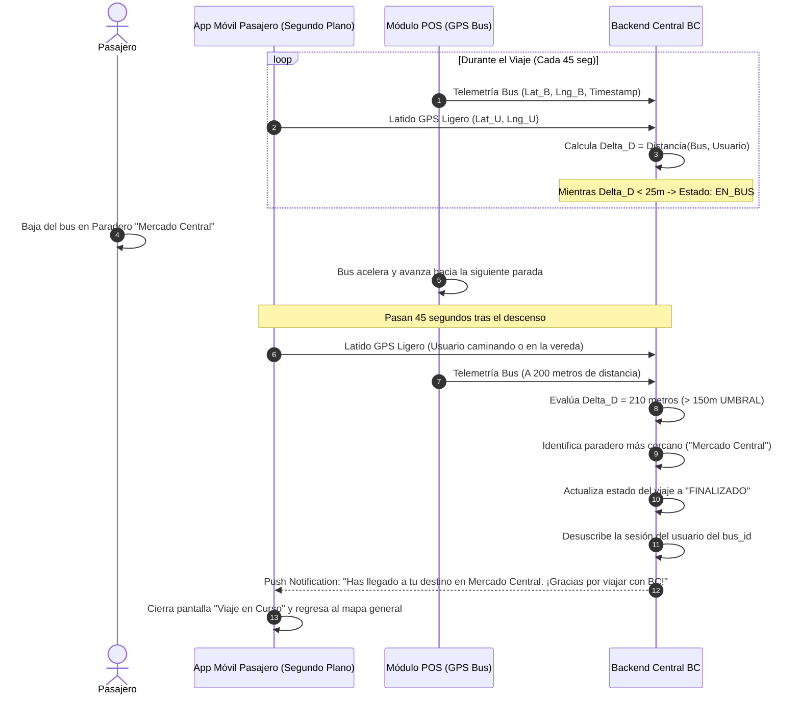

# Caso de Uso: CU-06 Descenso y Desacoplamiento por Geofencing
**Ubicación:** `docs/casos_de_uso/CU06_Descenso_Desacoplamiento_Geofencing.md`  
**Módulos Involucrados:** App Móvil Pasajero, POS Maestro en Bus (GPS), Backend Central BC  

---

## 1. Ficha del Caso de Uso

| Atributo | Detalle |
| :--- | :--- |
| **Identificador** | **CU-06** |
| **Nombre** | Detección de Descenso y Desuscripción de Ruta por Desacoplamiento |
| **Actores** | Pasajero (Portador de la app), Módulo POS (Nodo GPS del Bus), Backend Central BC |
| **Propósito** | Detectar de forma automática y energéticamente eficiente cuándo el usuario baja del bus en cualquier paradero para cerrar su sesión de viaje, actualizar el aforo y enviar la notificación de fin de viaje. |
| **Precondiciones** | El pasajero abordó la unidad y tiene un viaje en estado `ACTIVO` (tras completar el CU-01). El POS del bus transmite coordenadas GPS cada 3-5 segundos. |
| **Disparador** | El pasajero desciende físicamente del bus y la unidad continúa su recorrido alejándose. |

---

## 2. Flujo Principal (Camino Feliz: Desacoplamiento por Distancia)

---

## 3. Flujos Alternativos y Excepciones

### 3.1. Flujo Alternativo A: Usuario Seleccionó Parada de Destino (Alerta de Bajada)
* **Condición:** Al subir, el usuario marcó en la app: *"Bajaré en Paradero Univ. Jorge Basadre"*.
* **Comportamiento:**
  1. El backend monitorea la posición del **GPS del bus** contra la geocerca del paradero marcado.
  2. Cuando el bus se encuentra a **400 metros (o 1 paradero de distancia)**, la app del usuario emite una alarma sonora y vibración:  
     🔔 **"¡Atención: Próxima parada es tu destino!"**.
  3. El usuario se prepara y desciende con tranquilidad.
  4. El viaje se finaliza automáticamente por el desacoplamiento de distancia habitual.

### 3.2. Flujo Alternativo B: Fin de Recorrido del Bus (Llegada a Terminal)
* **Condición:** El usuario se queda dormido o viaja hasta el final de la línea.
* **Comportamiento:**
  1. El bus entra a la geocerca del terminal final de ruta.
  2. El chofer presiona en su tablet *"Finalizar Recorrido"*.
  3. El backend cierra automáticamente todas las sesiones que permanezcan en estado `ACTIVO` en esa unidad, marcando como punto de descenso el terminal.

### 3.3. Flujo Alternativo C: Teléfono del Usuario se Queda sin Batería
* **Condición:** El celular del usuario se apaga durante el trayecto.
* **Comportamiento:**
  1. La app deja de enviar latidos de ubicación.
  2. El backend no cobra nada adicional (el pasaje ya fue cobrado al inicio a tarifa plana).
  3. El viaje se auto-cierra tras cumplirse el timeout máximo de 60 minutos o al finalizar la vuelta del bus.

---

## 4. Postcondiciones
* Sesión de viaje en el backend actualizada a `FINALIZADO` con paradero de bajada estimado y duración del viaje.
* Desuscripción de la telemetría en vivo del bus (ahorro de batería en el móvil).
* Registro estadístico consolidado para el cálculo de origen-destino (O-D) de la línea de transporte.

