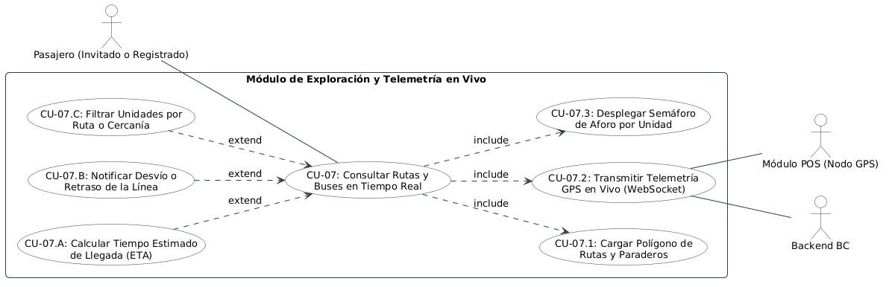

# Especificación Detallada de Caso de Uso: CU-07
## Exploración de Rutas y Seguimiento de Buses en Vivo (Modo Invitado)
**Documento UML:** `docs/casos_de_uso/CU07/CU07_Monitoreo_Rutas_Modo_Invitado.md`  
**Referencia UML:** `CU07` en [diagrama_casos_de_uso.puml](file:///Users/aron/githubRepo/sem-bus/docs/casos_de_uso/diagrama_casos_de_uso.puml)  
**Versión:** 2.0 (Análisis Riguroso y QA Ready)

---

## 1. Caracterización Formal del Caso de Uso

| Atributo | Definición Formal |
| :--- | :--- |
| **Identificador** | **CU-07** |
| **Nombre** | Consultar Rutas, Paraderos y Ubicación de Buses en Tiempo Real (Modo Invitado / Explorador) |
| **Nivel** | Objetivo de Usuario (User Goal) / Vista Principal de la Aplicación |
| **Actor Primario** | **Pasajero** (Anónimo / Invitado o Usuario Registrado) |
| **Actores Secundarios** | **Módulo POS en Bus** (Emisor de Coordenadas GPS), **Sistema Backend BC** |
| **Partes Interesadas** | *Ciudadano de Tacna:* Conocer exactamente a qué hora pasará el bus por su paradero para no esperar bajo el sol o el frío.<br>*Empresa de Transporte:* Visibilizar la frecuencia de sus unidades y desincentivar el transporte informal. |
| **Precondiciones** | La aplicación está instalada y abierta. El usuario cuenta con conexión a internet en su smartphone. |
| **Postcondición de Éxito** | El usuario visualiza el mapa interactivo con la traza de la ruta seleccionada, los paraderos georreferenciados y los buses moviéndose en tiempo real con su indicador semafórico de aforo. |
| **Postcondición de Falla** | Si se pierde la conexión, la app muestra la última posición conocida en caché con la leyenda *"Datos no sincronizados"* sin congelar la app. |
| **Disparador (Trigger)** | El usuario abre la App BC (o selecciona una línea de transporte en el catálogo). |

---

## 2. Diagrama UML de Casos de Uso (Estructura y Relaciones)

<div align="center">
  
  <p><em>Figura: Diagrama UML 2.5 del Caso de Uso con Actores, Caso Base, relaciones &laquo;include&raquo; y &laquo;extend&raquo;.</em></p>
</div>

---

## 3. Puntos de Inclusión (`<<include>>`) y Extensión (`<<extend>>`)

### 3.1. Casos de Uso Incluidos (`<<include>>`)
* **`<<include>> CU-07.1` (Cargar Polígono de Rutas y Paraderos):** Descarga y renderizado vectorial de la geometría de ida y vuelta de la línea de transporte.
* **`<<include>> CU-07.2` (Transmitir Telemetría GPS en Vivo vía WebSocket):** Conexión bidireccional continua de baja latencia recibiendo `(lat, lng, heading, speed)` cada 3 segundos.
* **`<<include>> CU-07.3` (Desplegar Semáforo de Aforo por Unidad):** Renderizado de la insignia de ocupación (🟢 Asientos libres, 🟡 De pie, 🔴 Lleno) sobre el ícono del bus en el mapa.

### 3.2. Puntos de Extensión (`<<extend>>`)

```
+---------------------------------------------------------------------------------------------------+
| PUNTO DE EXTENSIÓN 1: [PE-ETA-CALC] (Cálculo de Tiempo Estimado de Llegada)                        |
|   Extendido por: CU-07.A (Calcular Tiempo Estimado de Llegada a Paradero Seleccionado)            |
|   Condición de Activación: El usuario toca el ícono de un paradero en el mapa.                     |
+---------------------------------------------------------------------------------------------------+
| PUNTO DE EXTENSIÓN 2: [PE-ALERTA-DESVIO] (Tráfico Pesado o Desvío de Recorrido)                  |
|   Extendido por: CU-07.B (Notificar Desvío o Incidencia en la Línea)                              |
|   Condición de Activación: bus.coordenadas se desvían > 100m de la ruta oficial por > 3 minutos   |
+---------------------------------------------------------------------------------------------------+
| PUNTO DE EXTENSIÓN 3: [PE-FILTRO-CERCANIA] (Filtro Inteligente de Líneas)                         |
|   Extendido por: CU-07.C (Filtrar Unidades y Paraderos Más Cercanos al Usuario)                   |
|   Condición de Activación: El usuario concede permiso de GPS al abrir la app.                     |
+---------------------------------------------------------------------------------------------------+
```

---

## 4. Descripción Paso a Paso del Flujo

1. **[Apertura de la App]:** El usuario abre la App BC. El sistema no solicita registro ni tarjeta de crédito, entrando directamente a la vista de mapa centrada en Tacna.
2. **[Carga de Geometría - Inclusión CU-07.1]:**
   * La app consulta el catálogo local/remoto de rutas: `GET /api/v1/routes/LINEA_10/geometry`.
   * Renderiza la traza poligonal en color azul (Ida) y naranja (Vuelta) junto con los paraderos oficiales marcados con pines.
3. **[Suscripción Telemática - Inclusión CU-07.2]:**
   * La app abre un canal WebSocket liviano: `wss://api.bc.pe/ws/routes/LINEA_10/live`.
   * El backend despacha paquetes compactos en JSON/Protobuf cada 3 segundos con todas las unidades activas en esa línea:
     ```json
     {
       "bus_id": "BUS_01",
       "plate": "Z1A-780",
       "lat": -18.0084,
       "lng": -70.2450,
       "heading": 185.4,
       "speed_kmh": 32,
       "capacity_status": "SEATS_AVAILABLE"
     }
     ```
4. **[Renderizado en Pantalla - Inclusión CU-07.3]:**
   * El ícono del bus se anima suavemente sobre la calle con rotación angular según el rumbo (`heading`).
   * Sobre el bus se despliega un punto de color semafórico:
     * 🟢 Verde: Capacidad < 70% (Asientos disponibles).
     * 🟡 Amarillo: Capacidad 70% - 95% (Espacio de pie).
     * 🔴 Rojo: Capacidad > 95% (Bus saturado).
5. **[Interacción con Paradero - Extensión CU-07.A]:**
   * El usuario toca el paradero *"Mercado Central"*.
   * La app dibuja una tarjeta inferior que calcula la distancia al bus más próximo y su tiempo estimado de arribo (ETA): *"Bus más cercano a 4 paraderos (Tiempo estimado: 6 - 8 minutos)"*.
6. **[Cierre de Sesión o Navegación]:** El usuario guarda su celular informado de cuándo salir a esperar el bus.

---

## 5. Criterios de Aceptación para QA (Escenarios BDD / Cucumber)

```gherkin
Feature: Monitoreo de Rutas y Telemetría en Modo Invitado

  Scenario: Usuario anónimo visualiza ruta y buses sin registrarse
    Given que el usuario descarga la app por primera vez y no tiene cuenta
    When abre la aplicación en su smartphone
    Then la app despliega el mapa interactivo de Tacna
    And muestra el trazado de la ruta seleccionada
    And muestra las unidades de buses en movimiento con animación fluida

  Scenario: Cálculo de ETA al seleccionar un paradero
    Given que la unidad "BUS_01" avanza a 30 km/h y está a 1.5 km del paradero "Plaza Zela"
    When el usuario toca el pin del paradero "Plaza Zela"
    Then el sistema muestra una tarjeta con el tiempo estimado de llegada entre 3 a 5 minutos
    And el semáforo de aforo del bus indica "Asientos Disponibles"

  Scenario: Alerta visual de desvío de ruta
    Given que una unidad se desvía más de 100 metros del trazado oficial debido a una obra
    When el backend detecta la anomalía por más de 3 minutos consecutivos
    Then el ícono del bus en el mapa cambia a color naranja con ícono de advertencia
    And despliega la leyenda "Ruta con desvío temporal"
```

