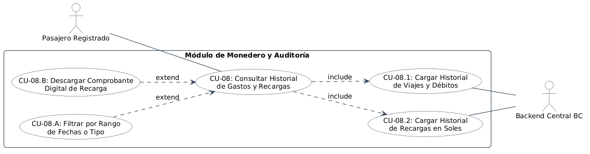

# Especificación Detallada de Caso de Uso: CU-08
## Consultar Historial de Gastos y Recargas (Monedero y Auditoría)
**Documento UML:** `docs/casos_de_uso/CU08/CU08_Historial_Gastos_Recargas.md`  
**Referencia UML:** `CU08` en [diagrama_casos_de_uso.puml](file:///Users/aron/githubRepo/sem-bus/docs/casos_de_uso/diagrama_casos_de_uso.puml)  
**Versión:** 2.0 (Análisis Riguroso y QA Ready)

---

## 1. Caracterización Formal del Caso de Uso

| Atributo | Definición Formal |
| :--- | :--- |
| **Identificador** | **CU-08** |
| **Nombre** | Consultar Historial de Gastos, Viajes y Recargas |
| **Nivel** | Objetivo de Usuario (User Goal) / Auditoría Financiera del Pasajero |
| **Actor Primario** | **Pasajero Registrado** |
| **Actores Secundarios** | **Sistema Backend BC** (Libro Mayor / Ledger) |
| **Partes Interesadas** | *Pasajero:* Desea transparencia absoluta sobre en qué gastó sus puntos y verificar sus recargas en soles.<br>*QA / Finanzas:* Disponer de conciliación exacta entre transacciones bancarias y débitos de pasaje. |
| **Precondiciones** | El usuario tiene sesión iniciada en la App BC. |
| **Postcondición de Éxito** | Se despliega la lista cronológica paginada de débitos por viajes (con fecha, hora, línea de bus y tarifa) y créditos por recargas (monto en soles, puntos asignados y pasarela). |
| **Postcondición de Falla** | Si no hay conexión, se muestra el historial almacenado en la caché local del dispositivo con indicador de última sincronización. |
| **Disparador (Trigger)** | El usuario presiona la pestaña *"Historial"* o el botón *"Ver Movimientos"* en su monedero digital. |

---

## 2. Diagrama UML de Casos de Uso (Estructura y Relaciones)

<div align="center">
  
  <p><em>Figura: Diagrama UML 2.5 del Caso de Uso con Actores, Caso Base, relaciones &laquo;include&raquo; y &laquo;extend&raquo;.</em></p>
</div>

---

## 3. Puntos de Inclusión (`<<include>>`) y Extensión (`<<extend>>`)

### 3.1. Casos de Uso Incluidos (`<<include>>`)
* **`<<include>> CU-08.1` (Cargar Historial de Viajes y Débitos):** Consulta paginada a la tabla `trips` y `ledger_transactions` (tipo `TRIP_DEBIT`), extrayendo fecha, placa del bus, paradero de subida, paradero de bajada y puntos debitados.
* **`<<include>> CU-08.2` (Cargar Historial de Recargas en Soles):** Consulta paginada a `recharges` y `ledger_transactions` (tipo `RECHARGE_CREDIT`), extrayendo importe en PEN, puntos abonados y pasarela utilizada (Yape/Tarjeta).

### 3.2. Puntos de Extensión (`<<extend>>`)

```
+---------------------------------------------------------------------------------------------------+
| PUNTO DE EXTENSIÓN 1: [PE-FILTRO-FECHAS] (Filtrado Avanzado)                                      |
|   Extendido por: CU-08.A (Filtrar por Rango de Fechas o Tipo de Movimiento)                       |
|   Condición de Activación: El usuario selecciona filtro (ej. 'Solo Viajes', 'Solo Recargas').     |
+---------------------------------------------------------------------------------------------------+
| PUNTO DE EXTENSIÓN 2: [PE-COMPROBANTE] (Descarga de Comprobante Fiscal/Digital)                   |
|   Extendido por: CU-08.B (Descargar / Compartir Comprobante Digital de Recarga)                   |
|   Condición de Activación: El usuario toca una transacción de recarga y presiona 'Ver Recibo'.    |
+---------------------------------------------------------------------------------------------------+
```

---

## 4. Descripción Paso a Paso del Flujo

1. **[Navegación]:** El usuario ingresa a la sección *"Movimientos"* de la App BC.
2. **[Consulta al Backend - Inclusión CU-08.1 y CU-08.2]:**
   * La app despacha: `GET /api/v1/wallet/ledger?page=1&limit=20`.
   * El backend consulta la base de datos con paginación basada en cursor (`cursor-based pagination` para alto rendimiento).
   * Retorna una lista estructurada y tipificada:
     ```json
     {
       "current_balance_points": 85,
       "transactions": [
         {
           "id": "TX-10928",
           "type": "TRIP_DEBIT",
           "amount_points": -15,
           "description": "Viaje Línea 10 - Placa Z1A-780",
           "origin_stop": "Cono Norte",
           "destination_stop": "Plaza Zela",
           "created_at": "2026-11-07T18:24:10Z"
         },
         {
           "id": "TX-10901",
           "type": "RECHARGE_CREDIT",
           "amount_points": +100,
           "amount_pen": 10.00,
           "method": "YAPE",
           "created_at": "2026-11-07T12:05:00Z"
         }
       ]
     }
     ```
3. **[Renderizado en Pantalla]:**
   * La app agrupa las transacciones por día (*"Hoy"*, *"Ayer"*, *"Esta Semana"*).
   * Los débitos se muestran con ícono de bus y texto en rojo (`-15 Pts` o `-7 Pts`).
   * Las recargas se muestran con ícono de billetera en verde (`+100 Pts / S/. 10.00`).
4. **[Detalle de Movimiento]:**
   * Al tocar un viaje, se abre una tarjeta modal con la ruta recorrida dibujada sobre un mini-mapa, la hora exacta de abordaje y la tarifa aplicada.

---

## 5. Criterios de Aceptación para QA (Escenarios BDD / Cucumber)

```gherkin
Feature: Consulta de Historial de Gastos y Recargas

  Scenario: Pasajero consulta su historial de viajes recientes
    Given que el usuario "U12" ha realizado 3 viajes y 1 recarga en las últimas 48 horas
    When accede a la pestaña "Movimientos" en la app
    Then el sistema despliega las 4 transacciones ordenadas cronológicamente
    And muestra el saldo actual de Puntos BC coincidente con el balance del libro mayor

  Scenario: Filtrado por solo recargas
    Given que el usuario tiene un historial mixto de viajes y recargas
    When selecciona el filtro "Solo Recargas"
    Then la vista oculta los débitos de pasajes
    And muestra únicamente las recargas con sus montos en Soles (PEN) y Puntos BC
```

