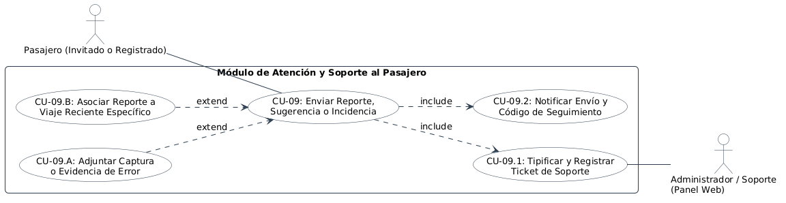

# Especificación Detallada de Caso de Uso: CU-09
## Enviar Reportes, Sugerencias y Soporte Técnico
**Documento UML:** `docs/casos_de_uso/CU09/CU09_Reportes_Sugerencias_Soporte.md`  
**Referencia UML:** `CU09` en [diagrama_casos_de_uso.puml](file:///Users/aron/githubRepo/sem-bus/docs/casos_de_uso/diagrama_casos_de_uso.puml)  
**Versión:** 2.0 (Análisis Riguroso y QA Ready)

---

## 1. Caracterización Formal del Caso de Uso

| Atributo | Definición Formal |
| :--- | :--- |
| **Identificador** | **CU-09** |
| **Nombre** | Enviar Reporte, Sugerencia, Incidencia de Viaje o Consulta de Soporte Técnico |
| **Nivel** | Proceso de Soporte / Atención al Cliente |
| **Actor Primario** | **Pasajero** (Invitado o Registrado) |
| **Actores Secundarios** | **Administrador / Mesa de Soporte (Panel Web)**, **Sistema Backend BC** |
| **Partes Interesadas** | *Pasajero:* Canal formal para reportar fallas en la app, cobros indebidos o quejas sin alterar la conducción.<br>*Conductor:* Protección contra interrupciones en cabina (el chofer no es distraído con quejas mientras maneja).<br>*Empresa de Transporte:* Detección temprana de bugs, fallas de unidades y retroalimentación para mejora continua. |
| **Precondiciones** | La aplicación está instalada y el usuario tiene acceso a la pantalla de "Ayuda y Soporte". |
| **Postcondición de Éxito** | Se crea un ticket de soporte con código de seguimiento único (`TKT-XXXX`), notificado al usuario y derivado a la bandeja web de atención. |
| **Postcondición de Falla** | Si no hay conexión a internet, el reporte se encola localmente en el dispositivo y se envía automáticamente cuando el celular recupere cobertura. |
| **Disparador (Trigger)** | El usuario selecciona *"Centro de Ayuda / Reportar un Problema"* en el menú lateral o tras finalizar un viaje. |

---

## 2. Diagrama UML de Casos de Uso (Estructura y Relaciones)

<div align="center">
  
  <p><em>Figura: Diagrama UML 2.5 del Caso de Uso con Actores, Caso Base, relaciones &laquo;include&raquo; y &laquo;extend&raquo;.</em></p>
</div>

---

## 3. Puntos de Inclusión (`<<include>>`) y Extensión (`<<extend>>`)

### 3.1. Casos de Uso Incluidos (`<<include>>`)
* **`<<include>> CU-09.1` (Tipificar y Registrar Ticket de Soporte):** Clasificación del reclamo según categorías estándar: *Problema con la App*, *Cobro Indebido*, *Conducta del Chofer / Manejo Temerario*, *Sugerencia de Mejora*, *Objeto Perdido*.
* **`<<include>> CU-09.2` (Notificar Envío y Código de Seguimiento):** Generación de ticket inmutable y confirmación en pantalla.

### 3.2. Puntos de Extensión (`<<extend>>`)

```
+---------------------------------------------------------------------------------------------------+
| PUNTO DE EXTENSIÓN 1: [PE-ADJUNTAR-FOTO] (Evidencia Gráfica)                                      |
|   Extendido por: CU-09.A (Adjuntar Captura de Pantalla o Fotografía de Evidencia)                 |
|   Condición de Activación: El usuario decide presionar 'Adjuntar Imagen' (máx. 5 MB).             |
+---------------------------------------------------------------------------------------------------+
| PUNTO DE EXTENSIÓN 2: [PE-VINCULAR-VIAJE] (Reclamo Específico de un Recorrido)                    |
|   Extendido por: CU-09.B (Asociar Reporte a un Viaje Reciente Específico)                         |
|   Condición de Activación: El usuario inicia el reporte desde el historial de viajes.             |
|   Regla de Negocio: Vincula automáticamente el bus_id, la placa y la hora exacta al ticket.       |
+---------------------------------------------------------------------------------------------------+
```

---

## 4. Descripción Paso a Paso del Flujo

1. **[Acceso]:** El usuario abre el menú de la App BC y toca *"Ayuda y Reportes"*.
2. **[Selección de Categoría - Inclusión CU-09.1]:**
   * Selecciona el motivo en una lista desplegable:
     * *Falla en cobro / Monedero*
     * *Problemas técnicos en la App*
     * *Reporte de servicio / Queja de ruta*
     * *Sugerencia general*
     * *Consulta de objeto olvidado* (Nota operativa: La app le recuerda que puede monitorear la unidad en vivo en el mapa bajo su propia decisión).
3. **[Puntos de Extensión PE-VINCULAR-VIAJE y PE-ADJUNTAR-FOTO]:**
   * Si el usuario venía de la pantalla de un viaje, la app adjunta automáticamente el identificador del bus (`bus_id: BUS_01`) y la placa (`Z1A-780`).
   * El usuario redacta una breve descripción del problema y opcionalmente adjunta una captura de pantalla.
4. **[Envío al Backend - Inclusión CU-09.2]:**
   * La app despacha:
     ```json
     POST /api/v1/support/tickets
     {
       "category": "APP_BUG",
       "subject": "Error al escanear QR",
       "description": "La cámara tardó en enfocar en el paradero Bolognesi",
       "trip_id": "TRP-8491",
       "device_info": "iPhone 16 - iOS 27.2",
       "attachment_url": "s3://support/tkt-evidence-01.jpg"
     }
     ```
   * El backend almacena el ticket en estado `OPEN` y notifica por Webhook a la mesa de ayuda de la empresa.
5. **[Confirmación]:**
   * La app muestra: *"¡Reporte enviado! Número de seguimiento: #TKT-4819. Nuestro equipo técnico revisará el caso"*.

---

## 5. Criterios de Aceptación para QA (Escenarios BDD / Cucumber)

```gherkin
Feature: Envío de Reportes y Sugerencias de Pasajeros

  Scenario: Pasajero envía reporte asociado a un viaje reciente
    Given que el usuario "U10" finalizó un viaje en la unidad "BUS_01"
    When inicia un reporte desde el detalle de ese viaje con categoría "COBRO_INDEBIDO"
    And adjunta una descripción del problema
    Then el backend genera un ticket vinculado a "U10", "BUS_01" y a la fecha/hora del viaje
    And retorna un identificador de ticket "TKT-XXXX"

  Scenario: Encolamiento offline de sugerencia sin internet
    Given que el usuario no tiene cobertura 4G en su celular
    When redacta una sugerencia y presiona "Enviar"
    Then la app guarda el reporte en cola local con estado "PENDING_SYNC"
    And lo despacha automáticamente al recuperar conexión a internet
```

