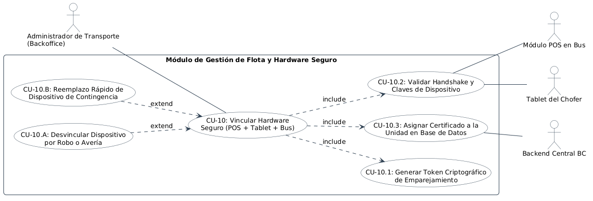

# Especificación Detallada de Caso de Uso: CU-10
## Vinculación Segura de Hardware (POS + Tablet + Bus) por el Administrador
**Documento UML:** `docs/casos_de_uso/CU10/CU10_Vinculacion_Segura_Hardware_Admin.md`  
**Referencia UML:** `CU10` en [diagrama_casos_de_uso.puml](file:///Users/aron/githubRepo/sem-bus/docs/casos_de_uso/diagrama_casos_de_uso.puml)  
**Versión:** 2.0 (Análisis Riguroso y QA Ready)

---

## 1. Caracterización Formal del Caso de Uso

| Atributo | Definición Formal |
| :--- | :--- |
| **Identificador** | **CU-10** |
| **Nombre** | Vinculación Segura de Hardware Físico (Módulo POS + Tablet del Chofer + Unidad de Bus) |
| **Nivel** | Proceso Administrativo y de Ciberseguridad / Gestión de Flota |
| **Actor Primario** | **Administrador de Transporte** (Usuario con rol de Super-Admin en Backoffice) |
| **Actores Secundarios** | **Módulo POS en Bus**, **Tablet del Chofer**, **Sistema Backend BC** |
| **Partes Interesadas** | *Empresa de Transporte:* Asegurar que ningún dispositivo externo o clonado pueda enviar cobros o telemetría falsa.<br>*Seguridad/QA:* Criptografía asimétrica y certificados únicos por hardware para evitar suplantación de identidad vehicular. |
| **Precondiciones** | El administrador tiene sesión activa en el Panel Web de Administración. Los dispositivos físicos (POS y Tablet) están encendidos en modo *"Esperando Emparejamiento"*. |
| **Postcondición de Éxito** | El POS y la Tablet quedan firmados criptográficamente y vinculados de forma unívoca a la placa vehicular del bus en la base de datos central. |
| **Postcondición de Falla** | Los dispositivos no emparejados son rechazados por la API y no pueden emitir cobros ni registrar turnos. |
| **Disparador (Trigger)** | El administrador registra un nuevo bus o equipa una unidad con hardware de reemplazo en el taller de la empresa. |

---

## 2. Diagrama UML de Casos de Uso (Estructura y Relaciones)

<div align="center">
  
  <p><em>Figura: Diagrama UML 2.5 del Caso de Uso con Actores, Caso Base, relaciones &laquo;include&raquo; y &laquo;extend&raquo;.</em></p>
</div>

---

## 3. Puntos de Inclusión (`<<include>>`) y Extensión (`<<extend>>`)

### 3.1. Casos de Uso Incluidos (`<<include>>`)
* **`<<include>> CU-10.1` (Generar Token Criptográfico de Emparejamiento):** Emisión desde el panel web de un QR de emparejamiento con clave asimétrica temporal de un solo uso (validez 15 minutos).
* **`<<include>> CU-10.2` (Validar Handshake y Claves de Dispositivo):** Intercambio de claves públicas (ECDSA/RSA) y MAC Address / Serial del POS y la Tablet con el servidor central.
* **`<<include>> CU-10.3` (Asignar Certificado a la Unidad en BD):** Registro en la tabla `hardware_pairing` que une `pos_id`, `tablet_id` y `bus_id`.

### 3.2. Puntos de Extensión (`<<extend>>`)

```
+---------------------------------------------------------------------------------------------------+
| PUNTO DE EXTENSIÓN 1: [PE-REVOCAR-EQUIPO] (Robo, Extravío o Avería)                               |
|   Extendido por: CU-10.A (Desvincular y Bloquear Dispositivo Remotamente)                         |
|   Condición de Activación: Administrador presiona 'Revocar Dispositivo' en el panel web.         |
|   Acción Inmediata: Invalidación de credenciales JWT/mTLS del equipo en menos de 1 segundo.      |
+---------------------------------------------------------------------------------------------------+
| PUNTO DE EXTENSIÓN 2: [PE-REEMPLAZO-RAPIDO] (Cambio de Hardware de Emergencia)                    |
|   Extendido por: CU-10.B (Reemplazo Rápido de Dispositivo de Contingencia)                        |
|   Condición de Activación: Se rompe una tablet y se asigna una unidad de repuesto en taller.      |
+---------------------------------------------------------------------------------------------------+
```

---

## 4. Descripción Paso a Paso del Flujo

1. **[Registro de Unidad en Backoffice]:** El administrador entra al módulo *"Gestión de Flota"* del panel web y selecciona la unidad (ej. *"Bus 01 - Placa Z1A-780"*).
2. **[Generación de Token Seguro - Inclusión CU-10.1]:**
   * Presiona el botón *"Emparejar Nuevo Hardware"*.
   * El backend genera un par de claves y expone en la pantalla del monitor un código QR maestro de aprovisionamiento:
     ```json
     {
       "pairing_token": "PAIR-94817-SECURE-UUID",
       "bus_id": "BUS_01",
       "expires_at": 1731001000
     }
     ```
3. **[Lectura por el Módulo POS]:**
   * El instalador técnico utiliza la cámara del POS maestro para escanear el QR del monitor del administrador.
4. **[Handshake Criptográfico - Inclusión CU-10.2]:**
   * El POS envía su identidad de hardware inalterable (Número de Serie del chipset y MAC Address) junto con el token:
     `POST /api/v1/hardware/handshake { pairing_token, device_serial: "POS-SN-88412", type: "MASTER_POS" }`.
   * El backend valida el token y le entrega un certificado de cliente mTLS / API Key de dispositivo de largo plazo.
5. **[Emparejamiento de la Tablet del Chofer]:**
   * Se repite el escaneo en la tablet de cabina.
   * La tablet queda asociada al mismo `bus_id`.
6. **[Asiento en Base de Datos - Inclusión CU-10.3]:**
   * La base de datos actualiza la tabla `buses`:
     * `buses.pos_device_id = 'POS-SN-88412'`
     * `buses.tablet_device_id = 'TAB-SN-10294'`
     * `buses.pairing_status = 'PAIRED_ACTIVE'`
7. **[Confirmación en Cabina]:**
   * La pantalla del POS y la Tablet emiten un tono de éxito y despliegan: *"Unidad Vinculada con Éxito a BUS 01 - Tacna"*.
   * Desde ese momento, cualquier transacción enviada por ese POS es firmada y reconocida automáticamente por el sistema.

---

## 5. Criterios de Aceptación para QA (Escenarios BDD / Cucumber)

```gherkin
Feature: Vinculación Segura de Hardware a Unidades de Bus

  Scenario: Emparejamiento exitoso de POS y Tablet a un Bus
    Given que el administrador inicia el aprovisionamiento para el bus "BUS_01"
    When genera el token maestro de emparejamiento
    And el técnico escanea el código en el POS y en la Tablet
    Then el backend registra la MAC y número de serie de ambos dispositivos
    And vincula unívocamente ambos equipos a "BUS_01"
    And los dispositivos quedan autorizados para emitir cobros y registrar turnos

  Scenario: Bloqueo remoto inmediato de dispositivo revocado
    Given que una tablet vinculada a "BUS_01" es reportada como robada o extraviada
    When el administrador presiona "Revocar Dispositivo" en el panel web
    Then el backend invalida inmediatamente las credenciales del equipo
    And cualquier petición posterior desde esa tablet es rechazada con HTTP 403 Forbidden
```

