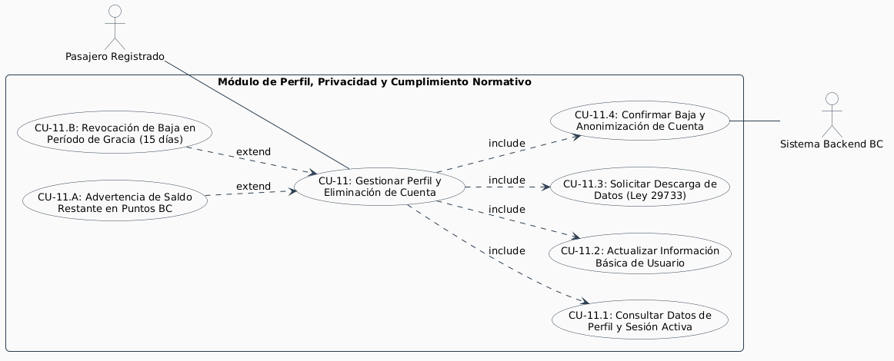

# Especificación Detallada de Caso de Uso: CU-11
## Gestión de Perfil, Privacidad y Eliminación de Cuenta
**Documento UML:** `docs/casos_de_uso/CU11/CU11_Gestion_Perfil_Eliminacion_Cuenta.md`  
**Referencia UML:** `CU11` en [diagrama_casos_de_uso.puml](file:///Users/aron/githubRepo/sem-bus/docs/casos_de_uso/diagrama_casos_de_uso.puml)  
**Versión:** 2.0 (Análisis Riguroso y QA Ready - Cumplimiento SWEBOK v4)

---

## 1. Caracterización Formal del Caso de Uso

| Atributo | Definición Formal |
| :--- | :--- |
| **Identificador** | **CU-11** |
| **Nombre** | Gestionar Perfil, Portabilidad de Datos y Eliminación Definitiva de Cuenta |
| **Nivel** | Objetivo de Usuario (User Goal) / Privacidad y Cumplimiento Normativo |
| **Actor Primario** | **Pasajero Registrado** |
| **Actores Secundarios** | **Sistema Backend BC** (Motor de Anonimización y Seguridad) |
| **Partes Interesadas** | *Pasajero:* Ejercer sus derechos ARCO (Acceso, Rectificación, Cancelación y Oposición) bajo la Ley 29733 de Protección de Datos Personales en Perú.<br>*Equipo Legal y QA:* Cumplir estrictamente con las directivas mandatorias de Google Play y Apple App Store sobre eliminación autónoma de cuentas desde la app móvil. |
| **Precondiciones** | El usuario tiene sesión activa autenticada en la App BC. |
| **Postcondición de Éxito** | 1. Si actualiza perfil: Información modificada y sincronizada en `users`.<br>2. Si solicita eliminación: Cuenta marcada como `PENDING_DELETION`, sesiones revocadas en todos los dispositivos (`user_sessions.is_active = FALSE`), y datos personales disociados/anonimizados tras cumplirse el período legal de 15 días. |
| **Postcondición de Falla** | La cuenta y monedero permanecen intactos si el usuario cancela la solicitud o no confirma el doble factor de seguridad. |
| **Disparador (Trigger)** | El usuario presiona *"Mi Cuenta"* -> *"Privacidad y Seguridad"* -> *"Eliminar mi cuenta"*. |

---

## 2. Diagrama UML de Casos de Uso (Estructura y Relaciones)

<div align="center">
  
  <p><em>Figura: Diagrama UML 2.5 del Caso de Uso con Actores, Caso Base, relaciones &laquo;include&raquo; y &laquo;extend&raquo;.</em></p>
</div>

---

## 3. Puntos de Inclusión (`<<include>>`) y Extensión (`<<extend>>`)

### 3.1. Casos de Uso Incluidos (`<<include>>`)
* **`<<include>> CU-11.1` (Consultar Datos de Perfil y Sesión Activa):** Lectura del nombre, teléfono, rol tarifario, fecha de registro y fingerprint del dispositivo activo (`current_device_id`).
* **`<<include>> CU-11.2` (Actualizar Información Básica de Usuario):** Edición de nombre visible o preferencias de accesibilidad.
* **`<<include>> CU-11.3` (Solicitar Descarga de Datos Personales):** Generación de paquete ZIP descargable con historial de viajes, recargas y datos de perfil en formato JSON estándar (Portabilidad de Datos - Ley 29733).
* **`<<include>> CU-11.4` (Confirmar Baja y Anonimización de Cuenta):** Desafiliación con validación de OTP de seguridad, revocación de JWTs e inicio de cronograma de anonimización irreversibles.

### 3.2. Puntos de Extensión (`<<extend>>`)

```
+---------------------------------------------------------------------------------------------------+
| PUNTO DE EXTENSIÓN 1: [PE-SALDO-RESTANTE] (Usuario posee Puntos BC sin consumir)                  |
|   Extendido por: CU-11.A (Advertencia de Saldo Restante en Puntos BC)                             |
|   Condición de Activación: wallet.points_balance > 0 al momento de solicitar eliminación          |
|   Comportamiento: Advierte pérdida de puntos prepago no reembolsables o canaliza soporte previo.  |
+---------------------------------------------------------------------------------------------------+
| PUNTO DE EXTENSIÓN 2: [PE-CANCELAR-BAJA] (Reversión durante período de gracia)                    |
|   Extendido por: CU-11.B (Revocación de Baja en Período de Gracia de 15 Días)                     |
|   Condición de Activación: Usuario reingresa con OTP antes de 15 días posteriores a solicitud.    |
|   Comportamiento: Restaura la cuenta a estado ACTIVE previa confirmación explícita.               |
+---------------------------------------------------------------------------------------------------+
```

---

## 4. Descripción Paso a Paso del Flujo

### 4.1. Flujo de Consulta y Actualización
1. El usuario navega a *"Ajustes de Perfil"*.
2. La app ejecuta `GET /api/v1/users/me` (**CU-11.1**) y despliega su número de celular, nombre, categoría de tarifa y fecha de registro.
3. El usuario puede modificar su nombre o alias presionando `[Guardar Cambios]` (`PATCH /api/v1/users/me`) (**CU-11.2**).

### 4.2. Flujo de Descarga de Información Personal (Portabilidad)
1. El usuario presiona *"Exportar mis datos"*.
2. El backend empaqueta su historial de viajes, transacciones de recargas y tickets de soporte en formato JSON estructurado (**CU-11.3**).
3. La app permite guardar el archivo o compartirlo mediante el share-sheet del sistema operativo.

### 4.3. Flujo Crítico de Eliminación de Cuenta (Requisito Apple / Google)
1. El usuario presiona el botón rojo *"Eliminar mi cuenta"*.
2. **Evaluación de Saldo [PE-SALDO-RESTANTE]:**
   * Si `wallets.points_balance > 0`, el sistema muestra una ventana emergente obligatoria: *"Tienes X Puntos BC (equivalente a S/. Y.YY). Al eliminar tu cuenta perderás este saldo de forma definitiva"*. El usuario debe marcar el checkbox de conformidad (**CU-11.A**).
3. **Verificación de Seguridad:** El backend despacha un SMS/WhatsApp OTP de 6 dígitos al número titular para evitar eliminaciones maliciosas por terceros.
4. El usuario ingresa el código de confirmación.
5. **Ejecución de Baja en Backend [CU-11.4]:**
   * El estado del usuario en `users` cambia a `is_active = FALSE`.
   * Se invalidan inmediatamente todos los registros en `user_sessions` (`is_active = FALSE`, `revoked_at = NOW()`).
   * Se programa un job nocturno diferido a 15 días para anonimizar datos:
     * El número de teléfono se sustituye por un hash irreversibles (`ANON-SHA256`).
     * El nombre se convierte en `Usuario Anonimizado`.
     * Las transacciones en el libro mayor (`ledger_transactions`) y viajes (`trips`) se conservan sin datos personales para preservar la integridad contable y legal exigida por SUNAT/MTC.
6. La app cierra sesión de inmediato, purga el almacenamiento local y regresa al Modo Invitado con notificación de confirmación.

---

## 5. Criterios de Aceptación para QA (Escenarios BDD / Cucumber)

```gherkin
Feature: Gestión de Perfil y Eliminación de Cuenta
  Como pasajero registrado
  Quiero gestionar mis datos personales y poder dar de baja mi cuenta
  Para ejercer mis derechos de privacidad y cumplir directivas de tiendas móviles

  Scenario: Eliminación exitosa de cuenta con saldo cero
    Given que el usuario "U30" tiene saldo de "0 Puntos BC" y sesión activa
    When solicita la eliminación de su cuenta desde la app
    And confirma el código OTP de verificación de identidad
    Then el backend marca la cuenta como "is_active = false"
    And revoca todas las sesiones activas en "user_sessions"
    And la app borra los tokens del almacenamiento seguro nativo
    And redirige al usuario a la vista de mapa en Modo Invitado

  Scenario: Advertencia de pérdida de saldo en cuenta con puntos restantes
    Given que el usuario "U31" tiene un saldo de "45 Puntos BC"
    When presiona el botón "Eliminar mi cuenta"
    Then la app muestra la advertencia "Perderás tus 45 Puntos BC acumulados"
    And deshabilita el botón de confirmación hasta que el usuario marque la casilla de aceptación

  Scenario: Restauración de cuenta dentro del período de gracia de 15 días
    Given que el usuario solicitó la baja de su cuenta hace 4 días
    When intenta iniciar sesión nuevamente con su número telefónico y código OTP
    Then el sistema detecta el estado de baja programada
    And muestra el modal "¿Deseas reactivar tu cuenta y cancelar la eliminación?"
    When el usuario selecciona "Reactivar cuenta"
    Then el estado se actualiza a "is_active = true" y el saldo original se mantiene intacto
```

