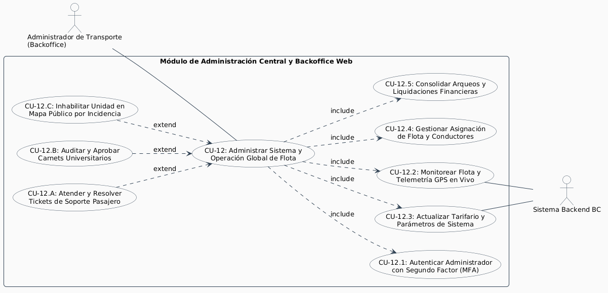

# Especificación Detallada de Caso de Uso: CU-12
## Panel de Administración Central (Backoffice Web)
**Documento UML:** `docs/casos_de_uso/CU12/CU12_Panel_Administracion_Backoffice_Web.md`  
**Referencia UML:** `CU12` en [diagrama_casos_de_uso.puml](file:///Users/aron/githubRepo/sem-bus/docs/casos_de_uso/diagrama_casos_de_uso.puml)  
**Versión:** 2.0 (Análisis Riguroso y QA Ready - Cumplimiento SWEBOK v4)

---

## 1. Caracterización Formal del Caso de Uso

| Atributo | Definición Formal |
| :--- | :--- |
| **Identificador** | **CU-12** |
| **Nombre** | Operar y Supervisar el Sistema de Transporte desde Panel Web (Backoffice) |
| **Nivel** | Proceso Administrativo y de Control Operativo Global |
| **Actor Primario** | **Administrador de Transporte** (Rol `ADMIN` en `users`) |
| **Actores Secundarios** | **Sistema Backend Central BC**, **Base de Datos PostgreSQL (Ledger y Telemetría)** |
| **Partes Interesadas** | *Empresa de Transporte:* Visibilidad centralizada de recaudación, kilometraje, cumplimiento de horarios y estado de flota.<br>*Entidades Reguladoras (MTC / Municipalidad Provincial de Tacna):* Acceso a auditorías de aforo y cumplimiento de tarifas legales.<br>*QA / Operaciones:* Configurar parámetros en caliente sin necesidad de re-desplegar microservicios. |
| **Precondiciones** | El administrador cuenta con credenciales activas con rol `ADMIN` y dispositivo autenticador TOTP/MFA configurado. |
| **Postcondición de Éxito** | Acceso al panel con visualización de mapa global de flota, arqueos consolidados en tiempo real, gestión de incidencias y actualización auditada de tablas de configuración (`fare_config`, `app_config`). |
| **Postcondición de Falla** | Bloqueo de acceso tras 3 intentos fallidos de credenciales o MFA inválido; registro de intento en auditoría de seguridad. |
| **Disparador (Trigger)** | El administrador accede a la URL segura `https://admin.bc.pe` desde su navegador de escritorio. |

---

## 2. Diagrama UML de Casos de Uso (Estructura y Relaciones)

<div align="center">
  
  <p><em>Figura: Diagrama UML 2.5 del Caso de Uso con Actores, Caso Base, relaciones &laquo;include&raquo; y &laquo;extend&raquo;.</em></p>
</div>

---

## 3. Puntos de Inclusión (`<<include>>`) y Extensión (`<<extend>>`)

### 3.1. Casos de Uso Incluidos (`<<include>>`)
* **`<<include>> CU-12.1` (Autenticar Administrador con Segundo Factor):** Login mediante usuario/contraseña con hash Argon2/bcrypt + código TOTP de 6 dígitos (Google Authenticator / Authy).
* **`<<include>> CU-12.2` (Monitorear Flota y Telemetría GPS en Vivo):** Panel cartográfico interactivo que muestra todas las unidades activas (visibles y pausadas), velocidad, rumbo y estado semafórico de aforo.
* **`<<include>> CU-12.3` (Actualizar Tarifario y Parámetros del Sistema):** Edición auditada de valores en `fare_config` (tarifas Adulto/Estudiante/CONADIS) y `app_config` (días de gracia SUNEDU, umbrales de geofencing).
* **`<<include>> CU-12.4` (Gestionar Asignación de Flota y Conductores):** Alta y edición de rutas (`routes`), paraderos (`stops`), vinculación de choferes (`drivers`) y asignación de buses (`buses`).
* **`<<include>> CU-12.5` (Consolidar Arqueos y Liquidaciones Financieras):** Reportes en tiempo real del dinero recaudado por App (Puntos BC), Yape Directo y conteo de gratuidades CONADIS con exportación a Excel/PDF.

### 3.2. Puntos de Extensión (`<<extend>>`)

```
+---------------------------------------------------------------------------------------------------+
| PUNTO DE EXTENSIÓN 1: [PE-TICKETS-SOPORTE] (Atención de Reclamos y Soporte)                       |
|   Extendido por: CU-12.A (Atender y Resolver Tickets de Soporte Pasajero)                         |
|   Condición de Activación: Ingreso de nuevo ticket en 'support_tickets' con estado OPEN.          |
+---------------------------------------------------------------------------------------------------+
| PUNTO DE EXTENSIÓN 2: [PE-CARNETS-PENDIENTES] (Revisión de Evidencia Fotográfica)                |
|   Extendido por: CU-12.B (Auditar y Aprobar Carnets Universitarios en Cola Manual)                |
|   Condición de Activación: Solicitudes en 'student_verifications' derivadas por falla de QR.     |
+---------------------------------------------------------------------------------------------------+
| PUNTO DE EXTENSIÓN 3: [PE-PAUSA-REMOTA] (Incidencia en Ruta)                                      |
|   Extendido por: CU-12.C (Inhabilitar Unidad en Mapa Público por Incidencia)                      |
|   Condición de Activación: Admin detecta desvío mayor, avería o desacato de ruta.                 |
+---------------------------------------------------------------------------------------------------+
```

---

## 4. Descripción Paso a Paso del Flujo

### 4.1. Autenticación y Acceso Seguro (CU-12.1)
1. El Administrador navega a `https://admin.bc.pe`.
2. Ingresa su correo institucional y contraseña maestra.
3. El sistema solicita el código TOTP de 6 dígitos.
4. Tras validación exitosa, se emite un JWT administrativo con claim `role: 'ADMIN'` y expiración corta (4 horas) con renovación por IP fija autorizada.

### 4.2. Monitoreo Global de Flota en Vivo (CU-12.2)
1. El panel despliega el mapa cartográfico de Tacna con capas vectoriales de todas las líneas de transporte.
2. Cada bus transmite telemetría mediante WebSocket cada 3 a 5 segundos (`v_buses_realtime`).
3. El administrador puede visualizar unidades operativas (ícono verde), unidades en parada prolongada (amarillo) y **unidades con incidencia / pausadas** (ícono gris con candado).
4. Al hacer clic sobre cualquier bus, se muestra: chofer a cargo, turno activo (`shifts`), aforo estimado y velocidad actual.

### 4.3. Configuración en Caliente de Tarifas y Parámetros (CU-12.3)
1. El administrador ingresa a *"Configuración de Tarifas"*.
2. Modifica el costo de la tarifa universitaria (ej. de 7 a 8 puntos).
3. El backend actualiza `fare_config`:
   ```sql
   UPDATE fare_config
   SET points_cost = 8, amount_pen = 0.80, updated_by = $admin_id, updated_at = NOW()
   WHERE fare_type = 'STUDENT';
   ```
4. Se emite un evento de invalidación de caché a todas las instancias backend y módulos POS en buses para aplicar el nuevo cobro sin reiniciar servicios.

### 4.4. Auditoría de Liquidaciones y Finanzas (CU-12.5)
1. Al cierre del día, el administrador visualiza la pantalla *"Arqueo Consolidado de Caja"*.
2. El sistema totaliza:
   * Recaudación App BC (Monedero prepago).
   * Recaudación Bancarizada Yape/Plin (cuentas bancarias recaudadoras).
   * Registro de pasajeros exonerados (CONADIS).
3. Permite cotejar los arqueos enviados por cada tablet de chofer (`shifts.ended_at`) contra los asientos reales registrados en `ledger_transactions`.

---

## 5. Criterios de Aceptación para QA (Escenarios BDD / Cucumber)

```gherkin
Feature: Operación del Panel de Administración Backoffice
  Como Administrador de Transporte
  Quiero supervisar la flota y configurar los parámetros del sistema
  Para garantizar la continuidad operativa y la transparencia financiera

  Scenario: Monitoreo de unidad pausada en mapa público
    Given que el chofer del bus "BUS_02" activó el interruptor "Pausar en Mapa Público"
    When el Administrador consulta la consola de monitoreo web
    Then el sistema muestra la unidad "BUS_02" en el mapa del Backoffice con estado "PAUSED"
    And muestra el motivo de la pausa reportado
    And confirma que la unidad permanece oculta en la API pública de pasajeros

  Scenario: Modificación en caliente de días de gracia SUNEDU
    Given que el gobierno emite un decreto de prórroga de carnets por 60 días
    When el Administrador actualiza "sunedu_grace_days" a "60" en el panel web
    Then el backend impacta la tabla "app_config"
    And las solicitudes de verificación universitaria posteriores calculan la vigencia con 60 días adicionales
    And registra el identificador del Administrador en "updated_by"

  Scenario: Resolución de ticket de soporte por cobro indebido
    Given un ticket de soporte en estado "OPEN" con ID "TKT-104" asociado a un viaje
    When el Administrador valida el incidente y selecciona "Aprobar Reembolso de 15 Puntos"
    Then el sistema ejecuta la reversión en "ledger_transactions" (tipo REFUND_CREDIT)
    And acredita los 15 puntos en el monedero del usuario afectado
    And actualiza el estado del ticket a "RESOLVED" con notas de auditoría
```

