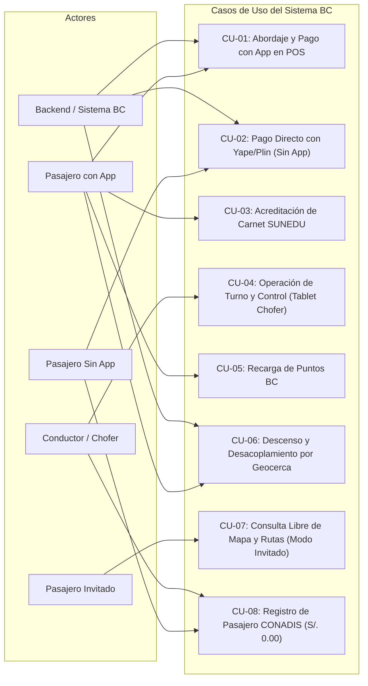

# Proyecto BC - Catálogo y Diagrama de Casos de Uso (MVP)
**Ubicación:** `docs/casos_de_uso/README.md`  
**Versión:** 1.0

---

## 1. Diagrama General de Casos de Uso

---

## 2. Índice de Especificación Detallada de Casos de Uso

| Código | Nombre del Caso de Uso | Actores Principales | Documento de Detalle |
| :--- | :--- | :--- | :--- |
| **CU-01** | Abordaje y Pago con App en POS | Pasajero, POS en Bus, Tablet Chofer | [CU01_Abordaje_Pago_App.md](file:///Users/aron/githubRepo/sem-bus/docs/casos_de_uso/CU01_Abordaje_Pago_App.md) |
| **CU-02** | Pago Directo con Yape/Plin (Sin App) | Pasajero sin App, POS en Bus, Pasarela Bancaria | [CU02_Pago_Yape_Directo_Sin_App.md](file:///Users/aron/githubRepo/sem-bus/docs/casos_de_uso/CU02_Pago_Yape_Directo_Sin_App.md) |
| **CU-03** | Acreditación de Carnet Universitario | Pasajero Estudiante, SUNEDU, Backend | [CU03_Acreditacion_Carnet_SUNEDU.md](file:///Users/aron/githubRepo/sem-bus/docs/casos_de_uso/CU03_Acreditacion_Carnet_SUNEDU.md) |
| **CU-04** | Operación de Turno en Tablet | Conductor, Backend | [CU04_Operacion_Turno_Conductor_Tablet.md](file:///Users/aron/githubRepo/sem-bus/docs/casos_de_uso/CU04_Operacion_Turno_Conductor_Tablet.md) |
| **CU-05** | Recarga de Puntos BC | Pasajero, Pasarela de Pagos (Yape/Plin/Tarjeta) | [CU05_Recarga_Puntos_BC.md](file:///Users/aron/githubRepo/sem-bus/docs/casos_de_uso/CU05_Recarga_Puntos_BC.md) |
| **CU-06** | Descenso y Desacoplamiento GPS | Pasajero, Backend, GPS Bus | [CU06_Descenso_Desacoplamiento_Geofencing.md](file:///Users/aron/githubRepo/sem-bus/docs/casos_de_uso/CU06_Descenso_Desacoplamiento_Geofencing.md) |

