```mermaid
flowchart TD
    subgraph Actores["Actores del Sistema"]
        P[Pasajero Registrado]
        E[Pasajero Estudiante]
        PD[Pasajero Sin App]
        C[Conductor / Chofer]
        B[Backend BC]
        Bank[Pasarela Bancaria]
        Sun[Servicio SUNEDU]
    end

    subgraph Paquete_Abordaje["Gestión de Abordaje y Pasajes"]
        CU01(["CU-01: Abordar y Pagar Pasaje con App"]):::core
        CU01_1(["CU-01.1: Validar y Debitar Puntos"]):::inc
        CU01_2(["CU-01.2: Emitir Feedback en POS y Tablet"]):::inc
        CU01_3(["CU-01.3: Suscribir Sesión a Unidad"]):::inc

        CU01_A(["CU-01.A: Aplicar Tarifa Universitaria (7 Pts)"]):::ext
        CU01_B(["CU-01.B: Agregar Pasajes Acompañantes (+15 Pts)"]):::ext
        CU01_C(["CU-01.C: Notificar Saldo Insuficiente"]):::ext
        CU01_D(["CU-01.D: Manejar QR Expirado / Usado"]):::ext

        CU02(["CU-02: Pagar Directo con Yape/Plin (Sin App)"]):::core
        CU02_1(["CU-02.1: Procesar Transacción Bancaria"]):::inc
        CU02_A(["CU-02.A: Autorizar Manualmente por Timeout (5s)"]):::ext

        CU08(["CU-08: Registrar Abordaje Gratuito CONADIS"]):::core
    end

    subgraph Paquete_Monedero["Monedero Digital (Puntos BC)"]
        CU05(["CU-05: Recargar Puntos BC"]):::core
        CU05_1(["CU-05.1: Iniciar Intención de Pago"]):::inc
        CU05_2(["CU-05.2: Asentar en Libro Mayor Ledger"]):::inc
        CU05_A(["CU-05.A: Manejar Rechazo Bancario"]):::ext
    end

    subgraph Paquete_Acreditaciones["Acreditaciones y Beneficios"]
        CU03(["CU-03: Acreditar Carnet Universitario"]):::core
        CU03_1(["CU-03.1: Decodificar y Validar QR SUNEDU"]):::inc
        CU03_2(["CU-03.2: Verificar Unicidad de DNI en BD"]):::inc
        CU03_A(["CU-03.A: Derivar a Auditoría Manual"]):::ext
        CU03_B(["CU-03.B: Rechazar por Caducidad Vencida"]):::ext
    end

    subgraph Paquete_Flota["Operación y Control de Cabina"]
        CU04(["CU-04: Operar Turno de Conducción en Tablet"]):::core
        CU04_1(["CU-04.1: Autenticar Chofer por PIN"]):::inc
        CU04_2(["CU-04.2: Liquidar y Generar Arqueo"]):::inc
        CU04_A(["CU-04.A: Declarar Avería Mecánica / Reembolso"]):::ext
        CU04_B(["CU-04.B: Calibrar Aforo Desembarque"]):::ext
    end

    subgraph Paquete_Telemetria["Geofencing y Telemetría"]
        CU06(["CU-06: Descenso y Desacoplamiento por Distancia"]):::core
        CU06_1(["CU-06.1: Evaluar Distancia Bus vs Celular"]):::inc
        CU06_2(["CU-06.2: Finalizar Sesión y Desuscribir"]):::inc
        CU06_A(["CU-06.A: Emitir Alarma Anticipada Bajada"]):::ext
        CU06_B(["CU-06.B: Cierre Forzoso por Fin de Ruta"]):::ext
    end

    %% Relaciones Include y Extend CU-01
    CU01 -.->|<<include>>| CU01_1
    CU01 -.->|<<include>>| CU01_2
    CU01 -.->|<<include>>| CU01_3
    CU01_A -.->|<<extend>>| CU01
    CU01_B -.->|<<extend>>| CU01
    CU01_C -.->|<<extend>>| CU01
    CU01_D -.->|<<extend>>| CU01

    %% Relaciones CU-02
    CU02 -.->|<<include>>| CU02_1
    CU02 -.->|<<include>>| CU01_2
    CU02_A -.->|<<extend>>| CU02

    %% Relaciones CU-05
    CU05 -.->|<<include>>| CU05_1
    CU05 -.->|<<include>>| CU05_2
    CU05_A -.->|<<extend>>| CU05

    %% Relaciones CU-03
    CU03 -.->|<<include>>| CU03_1
    CU03 -.->|<<include>>| CU03_2
    CU03_A -.->|<<extend>>| CU03
    CU03_B -.->|<<extend>>| CU03

    %% Relaciones CU-04
    CU04 -.->|<<include>>| CU04_1
    CU04 -.->|<<include>>| CU04_2
    CU04_A -.->|<<extend>>| CU04
    CU04_B -.->|<<extend>>| CU04

    %% Relaciones CU-06
    CU06 -.->|<<include>>| CU06_1
    CU06 -.->|<<include>>| CU06_2
    CU06_A -.->|<<extend>>| CU06
    CU06_B -.->|<<extend>>| CU06

    %% Asociación de Actores
    P --> CU01
    P --> CU05
    P --> CU06
    E -.->|Es un| P
    E --> CU03

    PD --> CU02
    PD --> CU08

    C --> CU04
    C --> CU08
    C --> CU02_A

    CU02_1 --> Bank
    CU05_1 --> Bank
    CU03_1 --> Sun

    B --> CU01_1
    B --> CU01_3
    B --> CU04_A
    B --> CU06_1
    B --> CU06_2

    classDef core fill:#2563eb,stroke:#1d4ed8,color:#ffffff,stroke-width:2px;
    classDef inc fill:#059669,stroke:#047857,color:#ffffff,stroke-dasharray: 5 5;
    classDef ext fill:#d97706,stroke:#b45309,color:#ffffff,stroke-dasharray: 3 3;
```

# Proyecto BC - Catálogo y Diagramas UML de Casos de Uso (UML 2.5)
**Ubicación:** `docs/casos_de_uso/README.md`  
**Archivo PlantUML Fuente:** [diagrama_casos_de_uso.puml](file:///Users/aron/githubRepo/sem-bus/docs/casos_de_uso/diagrama_casos_de_uso.puml)  
**Versión:** 2.0 (Análisis Riguroso)

---

## 1. Diagrama General de Casos de Uso (UML 2.5 con `<<include>>` y `<<extend>>`)

---

## 2. Índice de Especificaciones Detalladas (Plantilla RUP / Cockburn)

| Código | Caso de Uso | Actores | Relaciones Clave | Enlace a Documento |
| :--- | :--- | :--- | :--- | :--- |
| **CU-01** | **Abordar y Pagar Pasaje con App** | Pasajero, POS, Tablet, Backend | `<<include>> CU-01.1, CU-01.2, CU-01.3` `<<extend>> CU-01.A, B, C, D` | [CU01_Abordaje_Pago_App.md](file:///Users/aron/githubRepo/sem-bus/docs/casos_de_uso/CU01_Abordaje_Pago_App.md) |
| **CU-02** | **Pagar Directo con Yape/Plin (Sin App)** | Pasajero Ocasional, POS, Banco, Chofer | `<<include>> CU-02.1, CU-01.2` `<<extend>> CU-02.A (Failsafe 5s)` | [CU02_Pago_Yape_Directo_Sin_App.md](file:///Users/aron/githubRepo/sem-bus/docs/casos_de_uso/CU02_Pago_Yape_Directo_Sin_App.md) |
| **CU-03** | **Acreditar Carnet Universitario** | Estudiante, SUNEDU, Backend | `<<include>> CU-03.1, CU-03.2` `<<extend>> CU-03.A (Auditoría), B (Vencido)` | [CU03_Acreditacion_Carnet_SUNEDU.md](file:///Users/aron/githubRepo/sem-bus/docs/casos_de_uso/CU03_Acreditacion_Carnet_SUNEDU.md) |
| **CU-04** | **Operar Turno de Conducción en Tablet** | Chofer, Tablet, Backend, Pasajeros | `<<include>> CU-04.1, CU-04.2` `<<extend>> CU-04.A (Avería), CU-08 (CONADIS)` | [CU04_Operacion_Turno_Conductor_Tablet.md](file:///Users/aron/githubRepo/sem-bus/docs/casos_de_uso/CU04_Operacion_Turno_Conductor_Tablet.md) |
| **CU-05** | **Recargar Puntos BC** | Pasajero, Pasarela de Pagos, Backend | `<<include>> CU-05.1, CU-05.2` `<<extend>> CU-05.A (Rechazo Banco)` | [CU05_Recarga_Puntos_BC.md](file:///Users/aron/githubRepo/sem-bus/docs/casos_de_uso/CU05_Recarga_Puntos_BC.md) |
| **CU-06** | **Descenso y Desacoplamiento por Distancia** | Backend, POS (GPS), App en Background | `<<include>> CU-06.1, CU-06.2` `<<extend>> CU-06.A (Alarma), B (Terminal)` | [CU06_Descenso_Desacoplamiento_Geofencing.md](file:///Users/aron/githubRepo/sem-bus/docs/casos_de_uso/CU06_Descenso_Desacoplamiento_Geofencing.md) |
