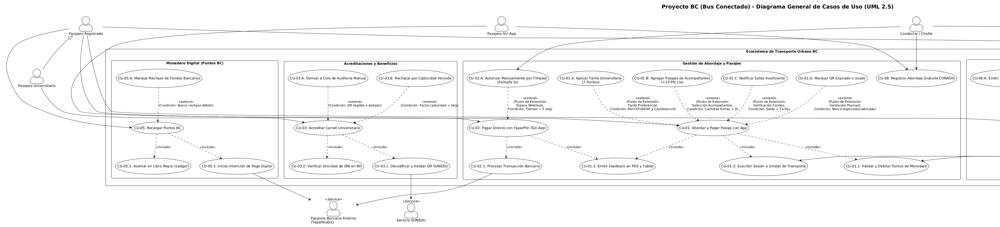

# Proyecto BC - Catálogo y Diagramas UML de Casos de Uso (UML 2.5)
**Ubicación:** `docs/casos_de_uso/README.md`  
**Archivo Fuente PlantUML:** [diagrama_casos_de_uso.puml](file:///Users/aron/githubRepo/sem-bus/docs/casos_de_uso/diagrama_casos_de_uso.puml)  
**Versión:** 2.0 (Análisis Riguroso)

---

## 1. Diagrama General de Casos de Uso (Renderizado en Alta Resolución 300 DPI)

---

## 2. Índice de Casos de Uso con sus Artefactos (.md, .puml, .png)

Cada caso de uso está organizado en su propia carpeta con su especificación formal en Markdown, su código fuente en PlantUML (`.puml`) y su renderizado en alta resolución (`.png`):

| Caso de Uso | Título y Descripción | Carpeta de Entregables | Archivo Markdown | Archivo PUML | Imagen Renderizada |
| :---: | :--- | :---: | :---: | :---: | :---: |
| **CU-01** | **Abordar y Pagar Pasaje con App (Core)** | [CU01/](file:///Users/aron/githubRepo/sem-bus/docs/casos_de_uso/CU01/) | [CU01_Abordaje_Pago_App.md](file:///Users/aron/githubRepo/sem-bus/docs/casos_de_uso/CU01/CU01_Abordaje_Pago_App.md) | [CU01.puml](file:///Users/aron/githubRepo/sem-bus/docs/casos_de_uso/CU01/CU01_Abordaje_Pago_App.puml) | [CU01.png](file:///Users/aron/githubRepo/sem-bus/docs/casos_de_uso/CU01/CU01_Abordaje_Pago_App.png) |
| **CU-02** | **Pagar Directo con Yape/Plin (Sin App)** | [CU02/](file:///Users/aron/githubRepo/sem-bus/docs/casos_de_uso/CU02/) | [CU02_Pago_Yape_Directo_Sin_App.md](file:///Users/aron/githubRepo/sem-bus/docs/casos_de_uso/CU02/CU02_Pago_Yape_Directo_Sin_App.md) | [CU02.puml](file:///Users/aron/githubRepo/sem-bus/docs/casos_de_uso/CU02/CU02_Pago_Yape_Directo_Sin_App.puml) | [CU02.png](file:///Users/aron/githubRepo/sem-bus/docs/casos_de_uso/CU02/CU02_Pago_Yape_Directo_Sin_App.png) |
| **CU-03** | **Acreditar Carnet Universitario (SUNEDU)** | [CU03/](file:///Users/aron/githubRepo/sem-bus/docs/casos_de_uso/CU03/) | [CU03_Acreditacion_Carnet_SUNEDU.md](file:///Users/aron/githubRepo/sem-bus/docs/casos_de_uso/CU03/CU03_Acreditacion_Carnet_SUNEDU.md) | [CU03.puml](file:///Users/aron/githubRepo/sem-bus/docs/casos_de_uso/CU03/CU03_Acreditacion_Carnet_SUNEDU.puml) | [CU03.png](file:///Users/aron/githubRepo/sem-bus/docs/casos_de_uso/CU03/CU03_Acreditacion_Carnet_SUNEDU.png) |
| **CU-04** | **Operar Turno de Conducción en Tablet** | [CU04/](file:///Users/aron/githubRepo/sem-bus/docs/casos_de_uso/CU04/) | [CU04_Operacion_Turno_Conductor_Tablet.md](file:///Users/aron/githubRepo/sem-bus/docs/casos_de_uso/CU04/CU04_Operacion_Turno_Conductor_Tablet.md) | [CU04.puml](file:///Users/aron/githubRepo/sem-bus/docs/casos_de_uso/CU04/CU04_Operacion_Turno_Conductor_Tablet.puml) | [CU04.png](file:///Users/aron/githubRepo/sem-bus/docs/casos_de_uso/CU04/CU04_Operacion_Turno_Conductor_Tablet.png) |
| **CU-05** | **Recargar Puntos BC mediante Pasarela** | [CU05/](file:///Users/aron/githubRepo/sem-bus/docs/casos_de_uso/CU05/) | [CU05_Recarga_Puntos_BC.md](file:///Users/aron/githubRepo/sem-bus/docs/casos_de_uso/CU05/CU05_Recarga_Puntos_BC.md) | [CU05.puml](file:///Users/aron/githubRepo/sem-bus/docs/casos_de_uso/CU05/CU05_Recarga_Puntos_BC.puml) | [CU05.png](file:///Users/aron/githubRepo/sem-bus/docs/casos_de_uso/CU05/CU05_Recarga_Puntos_BC.png) |
| **CU-06** | **Descenso y Desacoplamiento GPS** | [CU06/](file:///Users/aron/githubRepo/sem-bus/docs/casos_de_uso/CU06/) | [CU06_Descenso_Desacoplamiento_Geofencing.md](file:///Users/aron/githubRepo/sem-bus/docs/casos_de_uso/CU06/CU06_Descenso_Desacoplamiento_Geofencing.md) | [CU06.puml](file:///Users/aron/githubRepo/sem-bus/docs/casos_de_uso/CU06/CU06_Descenso_Desacoplamiento_Geofencing.puml) | [CU06.png](file:///Users/aron/githubRepo/sem-bus/docs/casos_de_uso/CU06/CU06_Descenso_Desacoplamiento_Geofencing.png) |
