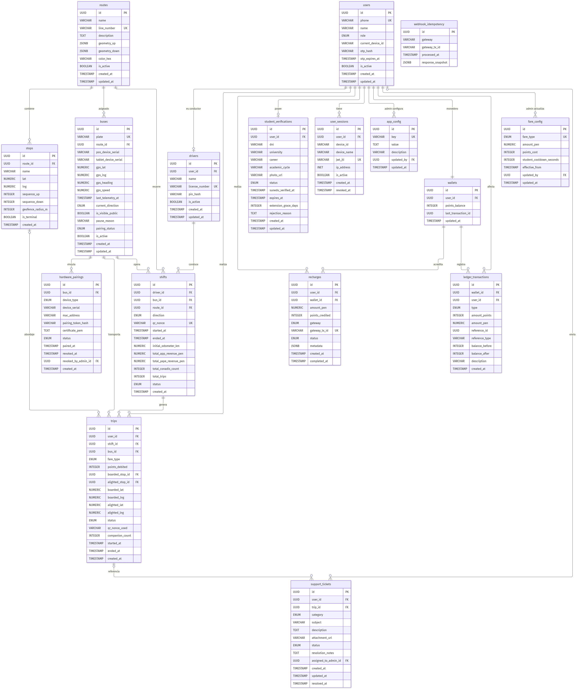

# Modelo Entidad-Relación — BC (Bus Conectado)

> **Versión:** 1.0.0 | **Fecha:** 2026-11-08 | **Estado:** APROBADO  
> **Estándar:** ISO/IEC 11179 (metadatos), SWEBOK v4 (diseño de datos)  
> **Motor BD:** PostgreSQL 15+

---

## 1. Diagrama ERD



> *Generado con Mermaid erDiagram vía Kroki.io — 17 entidades, 22 relaciones*

---

## 2. Descripción General de Entidades

El modelo de datos del sistema BC se organiza en **5 dominios funcionales**:

| Dominio | Entidades | Propósito |
|---------|-----------|-----------|
| **Identidad y Sesión** | `users`, `user_sessions`, `student_verifications`, `drivers` | Autenticación OTP, sesión única (Yape-style), acreditación universitaria SUNEDU |
| **Monedero y Finanzas** | `wallets`, `ledger_transactions`, `recharges`, `fare_config` | Saldo Puntos BC, libro mayor inmutable, recargas, tarifas configurables |
| **Flota y Rutas** | `routes`, `stops`, `buses` | Geometría de rutas, paraderos con geofencing, telemetría GPS en tiempo real |
| **Operación** | `shifts`, `trips`, `hardware_pairings` | Turnos de conducción, viajes individuales, vinculación segura POS/Tablet |
| **Soporte y Config** | `support_tickets`, `webhook_idempotency`, `app_config` | Tickets CU-09, deduplicación webhooks, parámetros globales |

---

## 3. Detalle de Entidades

### 3.1 `users` — Usuarios del Sistema

| Columna | Tipo | Restricciones | Descripción |
|---------|------|---------------|-------------|
| `id` | UUID | PK, DEFAULT gen_random_uuid() | Identificador único |
| `phone` | VARCHAR(15) | UNIQUE, NOT NULL | Número E.164: `+51XXXXXXXXX` |
| `name` | VARCHAR(100) | | Nombre completo |
| `role` | ENUM | NOT NULL, DEFAULT 'ADULT' | `ADULT` / `STUDENT` / `CONADIS` / `DRIVER` / `ADMIN` |
| `current_device_id` | VARCHAR(200) | | Fingerprint del dispositivo con sesión activa |
| `otp_hash` | VARCHAR(255) | | Hash bcrypt del OTP vigente (6 dígitos) |
| `otp_expires_at` | TIMESTAMPTZ | | Expiración del OTP (5 minutos) |
| `is_active` | BOOLEAN | NOT NULL, DEFAULT TRUE | Soft-delete / suspensión |
| `created_at` / `updated_at` | TIMESTAMPTZ | NOT NULL | Auditoría |

> **Regla de negocio:** `current_device_id` implementa la restricción de **1 sesión activa por usuario** (CU-00). Al autenticar en un nuevo dispositivo, se actualiza este campo y se revocan todas las sesiones previas en `user_sessions`.

---

### 3.2 `user_sessions` — Sesiones JWT Activas

| Columna | Tipo | Restricciones | Descripción |
|---------|------|---------------|-------------|
| `id` | UUID | PK | |
| `user_id` | UUID | FK → users, CASCADE | |
| `device_id` | VARCHAR(200) | NOT NULL | Fingerprint del dispositivo |
| `jwt_jti` | VARCHAR(255) | UNIQUE, NOT NULL | JWT ID para revocación individual |
| `is_active` | BOOLEAN | NOT NULL, DEFAULT TRUE | FALSE = revocada |
| `revoked_at` | TIMESTAMPTZ | | Timestamp de revocación |

> **Regla:** Al crear nueva sesión, `fn_revoke_previous_sessions()` invalida todas las anteriores del mismo `user_id`. Garantiza **1 sesión activa** en todo momento.

---

### 3.3 `student_verifications` — Verificación SUNEDU

| Columna | Tipo | Restricciones | Descripción |
|---------|------|---------------|-------------|
| `user_id` | UUID | FK, UNIQUE | 1 verificación por usuario |
| `status` | ENUM | NOT NULL | `PENDING` / `ACTIVE` / `EXPIRED` / `REJECTED` |
| `expires_at` | TIMESTAMPTZ | | Fin del período académico |
| `extension_grace_days` | INTEGER | DEFAULT 30 | Prórroga post-vencimiento (configurable en `app_config`) |
| `sunedu_verified_at` | TIMESTAMPTZ | | Timestamp de validación API SUNEDU |

> **Regla:** Un usuario con `status = ACTIVE` y `expires_at + extension_grace_days > NOW()` accede a tarifa universitaria (7 pts / S/. 0.70).

---

### 3.4 `wallets` — Monedero Puntos BC

| Columna | Tipo | Restricciones | Descripción |
|---------|------|---------------|-------------|
| `user_id` | UUID | FK, UNIQUE | 1 monedero por usuario |
| `points_balance` | INTEGER | NOT NULL, CHECK >= 0 | **Nunca negativo** |
| `last_transaction_id` | UUID | FK → ledger_transactions (DEFERRABLE) | Acceso rápido al último movimiento |

> **Regla de oro:** El CHECK constraint garantiza que `points_balance` nunca sea negativo. El débito se realiza siempre via `fn_debit_wallet()` con `SELECT...FOR UPDATE` (lock pesimista).

**Conversión:** 1 PEN = 10 Puntos BC
| Tarifa | PEN | Puntos |
|--------|-----|--------|
| Adulto | S/. 1.50 | 15 pts |
| Universitario | S/. 0.70 | 7 pts |
| CONADIS | S/. 0.00 | 0 pts |

---

### 3.5 `ledger_transactions` — Libro Mayor

Tabla **append-only** (inmutable). Nunca se borra ni modifica un registro. Para reversión se crea una nueva entrada `REFUND_CREDIT`.

| Columna | Tipo | Descripción |
|---------|------|-------------|
| `type` | ENUM | `RECHARGE_CREDIT` / `TRIP_DEBIT` / `REFUND_CREDIT` / `ADJUSTMENT` |
| `amount_points` | INTEGER | Positivo = crédito, negativo = débito |
| `balance_before` / `balance_after` | INTEGER | Saldo antes/después (auditoría completa) |
| `reference_id` | UUID | FK polimórfica → `recharges.id` o `trips.id` |
| `reference_type` | VARCHAR(20) | `'RECHARGE'` / `'TRIP'` / `'ADJUSTMENT'` |

---

### 3.6 `recharges` — Recargas de Saldo

| Columna | Tipo | Descripción |
|---------|------|-------------|
| `gateway` | ENUM | `YAPE` / `CARD` / `CASH_AGENT` |
| `gateway_tx_id` | VARCHAR(255) UNIQUE | ID del gateway bancario (idempotencia) |
| `status` | ENUM | `PENDING` → `COMPLETED` / `FAILED` / `REFUNDED` |
| `metadata` | JSONB | Datos adicionales del gateway (monto original, moneda, etc.) |

> **Idempotencia:** Antes de acreditar puntos, el backend verifica `webhook_idempotency(gateway, gateway_tx_id)`. Si existe, retorna 200 sin reprocesar.

---

### 3.7 `fare_config` — Tarifas Configurables

No hardcoded. El Admin puede modificar tarifas desde el backoffice en caliente.

| fare_type | amount_pen | points_cost | cooldown |
|-----------|-----------|-------------|---------|
| ADULT | S/. 1.50 | 15 | — |
| STUDENT | S/. 0.70 | 7 | 120s |
| CONADIS | S/. 0.00 | 0 | — |

> `student_cooldown_seconds = 120`: anti-fraude. Un mismo usuario universitario no puede pagar tarifa estudiantil dos veces en < 120 segundos.

---

### 3.8 `buses` — Flota con Telemetría GPS

| Columna | Tipo | Descripción |
|---------|------|-------------|
| `gps_lat` / `gps_lng` | NUMERIC(10,8) / (11,8) | Posición actual (actualizada cada ~45s por el POS) |
| `is_visible_public` | BOOLEAN DEFAULT TRUE | `FALSE` = oculto en mapa de pasajeros (Admin puede pausar) |
| `pause_reason` | VARCHAR(255) | "Llanta pinchada", "Desvío de ruta", etc. |
| `current_direction` | ENUM | `UP` (ida) / `DOWN` (vuelta) — invierte en paradero terminal |
| `pos_device_serial` | VARCHAR(100) | Serial del POS (contiene el GPS, conectado a 12V/24V del bus) |

> **Arquitectura GPS:** El GPS reside en el **POS** (siempre energizado por la batería del bus). La tablet del chofer NO tiene GPS primario.

---

### 3.9 `shifts` — Turnos de Conducción

| Columna | Tipo | Descripción |
|---------|------|-------------|
| `qr_nonce` | VARCHAR(255) UNIQUE | Nonce UUID del QR dinámico vigente en el POS |
| `direction` | ENUM | Dirección al iniciar el turno (UP o DOWN) |
| `total_app_revenue_pen` | NUMERIC(10,2) | Recaudación acumulada vía app BC |
| `total_yape_revenue_pen` | NUMERIC(10,2) | Recaudación acumulada vía Yape Directo |
| `total_conadis_count` | INTEGER | Número de pasajes CONADIS (gratuitos) |

> **QR Dinámico:** El `qr_nonce` se regenera en < 500ms tras cada cobro exitoso. El POS incluye `{bus_id, nonce, timestamp}` en el QR. La app valida que el nonce no haya sido usado antes (`trips.qr_nonce_used`).

---

### 3.10 `trips` — Viajes Individuales

| Columna | Tipo | Descripción |
|---------|------|-------------|
| `boarded_stop_id` / `alighted_stop_id` | UUID FK | Paradero de abordaje y descenso |
| `qr_nonce_used` | VARCHAR(255) | Nonce del QR escaneado (anti-replay, un solo uso) |
| `companion_count` | INTEGER DEFAULT 0 | Acompañantes pagados en la misma transacción (CU-01.B) |
| `status` | ENUM | `ACTIVE` → `COMPLETED` / `ABANDONED` |

> **Anti-double-spend:** Se verifica que `qr_nonce_used` no exista ya en ningún `trip` del turno actual antes de debitar.

---

### 3.11 `hardware_pairings` — Vinculación Segura POS/Tablet

| Columna | Tipo | Descripción |
|---------|------|-------------|
| `pairing_token_hash` | VARCHAR(255) | Hash del token QR de un solo uso generado por Admin |
| `certificate_pem` | TEXT | Certificado mTLS del dispositivo |
| `status` | ENUM | `PENDING` → `ACTIVE` / `REVOKED` |
| `revoked_by_admin_id` | UUID FK | Admin que revocó (trazabilidad) |

> **Flujo (CU-10):** Admin genera token QR → POS lo escanea → handshake mTLS → `status = ACTIVE`. Revocación inmediata disponible (ej. robo del dispositivo).

---

### 3.12 `support_tickets` — Tickets CU-09

| Columna | Tipo | Descripción |
|---------|------|-------------|
| `user_id` | UUID FK nullable | Nullable: permite reportes anónimos de invitados |
| `trip_id` | UUID FK nullable | Opcional: vincula el ticket a un viaje específico |
| `category` | ENUM | `BUG` / `SUGGESTION` / `PAYMENT_ISSUE` / `SAFETY` / `OTHER` |
| `assigned_to_admin_id` | UUID FK nullable | Admin asignado para resolver |

---

### 3.13 `webhook_idempotency` — Anti-replay Webhooks

| Columna | Tipo | Restricciones |
|---------|------|---------------|
| `gateway` | VARCHAR(50) | NOT NULL |
| `gateway_tx_id` | VARCHAR(255) | NOT NULL |
| | | UNIQUE(gateway, gateway_tx_id) |

> Antes de procesar cualquier webhook bancario (Yape, Visa, etc.), el backend hace `INSERT INTO webhook_idempotency ... ON CONFLICT DO NOTHING`. Si afecta 0 filas → ya procesado → retornar 200 sin reprocesar.

---

## 4. Funciones y Triggers PostgreSQL

| Función / Trigger | Propósito |
|-------------------|-----------|
| `fn_set_updated_at()` | Trigger BEFORE UPDATE que rellena `updated_at = NOW()` automáticamente |
| `fn_debit_wallet()` | Débito atómico con `SELECT...FOR UPDATE`. Previene double-spend concurrente |
| `fn_credit_wallet()` | Crédito atómico. Usado al completar una recarga |
| `fn_revoke_previous_sessions()` | Invalida sesiones previas al crear una nueva. Implementa sesión única |

---

## 5. Vistas Predefinidas

| Vista | Propósito | Usado en |
|-------|-----------|----------|
| `v_user_wallet_summary` | Saldo actual por usuario (puntos + PEN equivalente) | Backoffice Admin |
| `v_buses_realtime` | Telemetría GPS + estado actual de todos los buses | Mapa pasajeros + Admin |
| `v_user_transaction_history` | Historial unificado gastos + recargas | CU-08 app pasajero |

---

## 6. Índices Estratégicos

```sql
-- Sesión única: busca sesión activa por usuario rápidamente
idx_sessions_active    ON user_sessions(user_id, is_active) WHERE is_active = TRUE

-- Mapa en tiempo real: buses visibles
idx_buses_visible      ON buses(is_visible_public) WHERE is_visible_public = TRUE

-- Anti-double-spend: validar nonce QR en viaje activo
idx_trips_qr_nonce     ON trips(qr_nonce_used) WHERE qr_nonce_used IS NOT NULL

-- Historial de pasajero: orden cronológico eficiente
idx_ledger_user_created ON ledger_transactions(user_id, created_at DESC)

-- Webhook idempotencia: búsqueda O(1)
idx_webhook_gateway_txid ON webhook_idempotency(gateway, gateway_tx_id)
```

---

## 7. Reglas de Integridad Críticas

| # | Regla | Implementación |
|---|-------|----------------|
| RN-01 | Saldo nunca negativo | `CHECK (points_balance >= 0)` en `wallets` |
| RN-02 | 1 sesión activa por usuario | `fn_revoke_previous_sessions()` + `current_device_id` |
| RN-03 | Idempotencia webhooks | UNIQUE(gateway, gateway_tx_id) + INSERT ON CONFLICT |
| RN-04 | Anti-double-spend | `fn_debit_wallet()` con `SELECT...FOR UPDATE` |
| RN-05 | Anti-replay QR | `trips.qr_nonce_used` UNIQUE por turno |
| RN-06 | Libro mayor inmutable | ledger_transactions: nunca UPDATE/DELETE |
| RN-07 | 1 POS activo por bus | UNIQUE(bus_id, device_type) WHERE status='ACTIVE' |
| RN-08 | Tarifa configurable | fare_config: Admin modifica sin redeploy |
| RN-09 | GPS en POS no tablet | `buses.pos_device_serial` ≠ `tablet_device_serial` |
| RN-10 | Prórroga SUNEDU configurable | `app_config.sunedu_grace_days` sincronizado en student_verif |

---

## 8. Row Level Security (RLS)

Tablas con RLS habilitado (política via claim JWT `app.current_user_id`):

| Tabla | Regla |
|-------|-------|
| `wallets` | Usuario solo ve/modifica su propio monedero |
| `ledger_transactions` | Usuario solo ve sus propias transacciones |
| `trips` | Usuario solo ve sus propios viajes |
| `support_tickets` | Usuario solo ve sus propios tickets |
| `users` | Usuario solo ve/edita su propio perfil |

Administradores tienen acceso completo via rol de BD `bc_admin`.

---

## 9. Archivos Relacionados

| Archivo | Descripción |
|---------|-------------|
| [`01_ERD_BC.puml`](./01_ERD_BC.puml) | Fuente Mermaid erDiagram del ERD |
| [`01_ERD_BC.png`](./01_ERD_BC.png) | Diagrama compilado (689 KB, alta resolución) |
| [`02_Script_SQL_DDL.sql`](./02_Script_SQL_DDL.sql) | Script PostgreSQL 15+ completo con DDL, enums, triggers, funciones y vistas |

---

*Documento generado bajo estándares SWEBOK v4 / ISO/IEC 11179. Próximo paso: **API Contracts (OpenAPI 3.0)**.*

